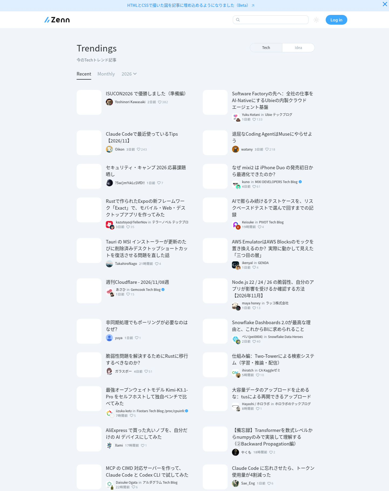
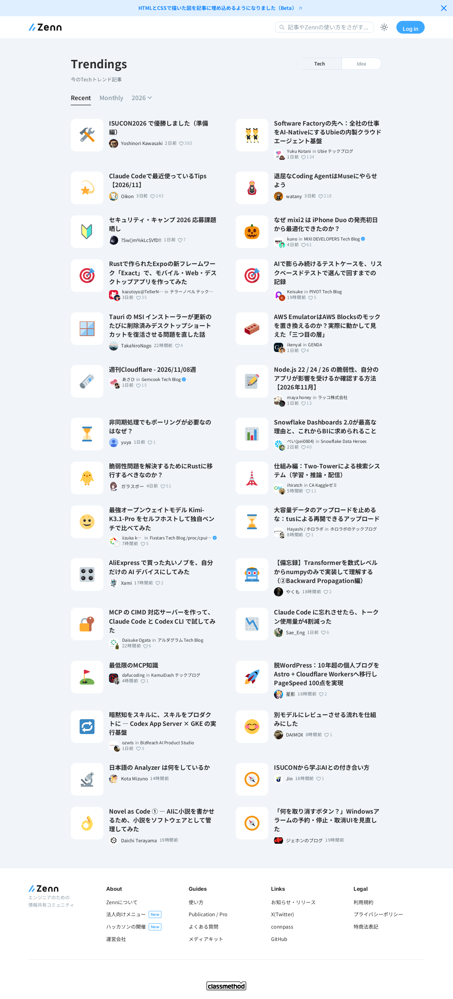

# はじめに

ヘッドレスブラウザで Web ページのレンダリングやスクリーンショット取得を行おうとすると、通常は Chromium をコンテナや専用サーバー上で動かす必要があり、起動コストやメモリ消費（数百 MiB〜）が重くなりがちです。

これに対して Cloudflare が公開した **[Kitesurf (`cloudflare/kitesurf`)](https://github.com/cloudflare/kitesurf)** は、コンテナを使わず **Cloudflare Workers（V8 アイソレート）と WebAssembly のみで動作するブラウザエンジン** です。AI エージェントや自動ワークロード向けにゼロから設計されており、Apache 2.0 ライセンスの OSS として公開されているほか、Cloudflare の Browser Run API からも `browser=kitesurf` を指定して利用できます。

この記事では、Kitesurf のアーキテクチャ、Chromium との違い、使い方（ローカル起動・CDP / Quick Action）、そして Dynamic Workers 分離に伴う費用感までを整理します。

---

# Kitesurf のアーキテクチャ

Kitesurf は「人間が操作するためのブラウザ機能（タブ管理・拡張機能・動画再生など）」を削ぎ落とし、ページ取得・レイアウト・スクリーンショット・DOM 操作といった用途に特化しています。

## 1. Rust + WebAssembly + V8 アイソレート

従来の C++ 製ブラウザエンジンを丸ごと移植するのではなく、Rust 製のコンポーネントを WebAssembly にコンパイルし、Cloudflare Workers 上で実行する構成をとっています。

- **CSS エンジン**: Mozilla 由来の **Stylo**
- **レイアウト・レンダリング基盤**: Dioxus エコシステムの **Blitz** などの Rust コンポーネント
- **JavaScript 実行環境**: Cloudflare Workers の V8 アイソレート

## 2. Dynamic Workers によるページ単位の分離

Kitesurf の大きな特徴は、Cloudflare の **Dynamic Workers（Worker Loader バインディング: `LOADER`）** を使ってページごとに実行環境を分離している点です。

主なコンポーネント構成は以下のようになっています。

- **`Engine`**: Chrome DevTools Protocol（CDP）サーバーおよび全体の調停役
- **`PageScript`**: ページごとの DOM、HTML/CSS パース、JavaScript ランタイムを担当
- **`PageRenderer`**: 記録されたシーンのラスタライズ・描画を担当
- **アウトバウンド制御（`SandboxOutbound` 等）**: 外部リクエストのフィルタリング、CORS 制御、ページ単位の Cookie 分離

ページを開くたびに独立したエフェメラルな Dynamic Worker（V8 アイソレート）が立ち上がり、ページを閉じるとその子 Worker ごとメモリ・`globalThis` 状態が破棄されます。すべてのページ読み込みを信頼できない入力として扱い、セッションやページ間での状態漏洩を防ぐステートレス設計です。

---

# Chromium との比較とトレードオフ

Cloudflare の公開ベンチマークでは、HTML 抽出やスクリーンショットなどのエージェント向けタスクにおいて、標準的なヘッドレス Chromium と比較して以下の特性が示されています。

| 観点 | Kitesurf の傾向 | 補足 |
| :--- | :--- | :--- |
| **メモリ使用量** | **大幅に少ない（最大で約 1/7）** | HTML 抽出タスク等で約 39.4 MiB vs Chromium 約 273.7 MiB |
| **CPU 効率** | **約 3.1〜3.8 倍省 CPU** | 不要な描画パイプラインを持たないため |
| **処理時間（Wall-clock）** | **約 1.7〜1.8 倍長い傾向** | 人間向けブラウザのような最適化がないため |

また、現時点の制約として以下は対象外（Chromium の代替にはならない領域）とされています。

- 動画ストリーミングや複雑な WebGL の描画
- TLS フィンガープリント等に依存する高度なボット対策の突破
- 長時間維持する永続的な認証済みブラウザセッション

---

# 使い方

Kitesurf は **Chrome DevTools Protocol（CDP）** を話せるため、Puppeteer などの既存ツールや、Cloudflare Browser Run の REST API（Quick Action）からそのまま利用できます。

## 1. Browser Run（Quick Action）でスクリーンショットを撮る

Cloudflare の Browser Run API を使う場合は、クエリパラメータに `browser=kitesurf` を付与するだけでエンジンを切り替えられます。

```bash
curl -X POST 'https://api.cloudflare.com/client/v4/accounts/<ACCOUNT_ID>/browser-run/screenshot?browser=kitesurf' \
  -H 'Authorization: Bearer <API_TOKEN>' \
  -H 'Content-Type: application/json' \
  -d '{ "url": "https://example.com" }' \
  --output "screenshot.png"
```

## 2. Puppeteer から CDP で接続する

```js
import puppeteer from "puppeteer-core";

async function captureWithKitesurf() {
  const browser = await puppeteer.connect({
    browserWSEndpoint:
      "wss://api.cloudflare.com/client/v4/accounts/<ACCOUNT_ID>/browser-run/devtools/browser?browser=kitesurf",
    // ローカルの wrangler dev に接続する場合:
    // browserWSEndpoint: "ws://127.0.0.1:8787",
  });

  try {
    const page = await browser.newPage();
    await page.goto("https://example.com");
    await page.screenshot({ path: "kitesurf-screenshot.png" });
  } finally {
    await browser.close();
  }
}

captureWithKitesurf();
```

## 3. OSS 版（`cloudflare/kitesurf`）をローカルで動かす

リポジトリをクローンして手元の `wrangler dev` 環境で起動することもできます（ビルドには Bazel 等を利用します）。

```bash
git clone https://github.com/cloudflare/kitesurf.git
cd kitesurf

pnpm install --frozen-lockfile
pnpm run dev
```

起動すると `http://127.0.0.1:8787` でランディングページとローカル CDP エンドポイントが立ち上がります。

---

# 自前運用する場合の Dynamic Workers 費用感

`cloudflare/kitesurf` を自分の Cloudflare アカウントへデプロイして運用する場合、**Workers Paid プラン（月額 $5）** と **Dynamic Workers** の課金体系が適用されます。

### 主な料金項目（Workers Paid プラン）

- **基本料**: **$5 / 月**
- **Dynamic Worker 生成費（ユニーク ID × 日）**:
  - 無料枠: **1,000 ユニーク / 月**
  - 超過: **$0.002 / ユニーク / 日**
- **CPU 時間（Active CPU Time）**:
  - 無料枠: **3,000 万 CPU ms / 月**
  - 超過: **$0.02 / 100 万 CPU ms**（`fetch` 等の I/O 待ち時間は非課金）
- **リクエスト数 / エグレス**:
  - リクエスト: 月 1,000 万回まで無料、超過 **$0.30 / 100 万回**
  - エグレス（転送量）: **無料**

### コスト上のポイント：ID 再利用の有無

Dynamic Workers は `env.LOADER.get(id, callback)` で同一 ID（＋同一コードハッシュ）を再利用すれば日次のユニーク数は 1 回しかカウントされませんが、Kitesurf はセキュリティ・状態分離のために**ページごとに独立したエフェメラル環境（`PageScript` / `PageRenderer`）を立ち上げて破棄する設計**になっています。

そのため、自前でホストして大量リクエストを処理する場合は、CPU 時間（1 回あたり数百 CPU ms なら約 $0.00001 前後）よりも **Dynamic Workers の生成課金（$0.002 / ユニーク、1 ページに複数ユニークならその分）** がコストの大部分を占める点に注意が必要です。

- 月 1,000 件程度まで: 基本料 **$5 / 月** の無料枠内
- リクエスト数が増える場合: ユニーク生成課金が効いてくるため、用途によってはマネージドな Browser Run API の利用や、1 Worker 内で完結する軽量 WASM レンダリングとの使い分けも検討対象になります。

### レンダリング動作を確認する

Zennをレンダリングしてみた結果、現在のバージョンだと一部画像が表示されないようです

https://live.browser.run/ui/view?wss=kitesurf.dev%2Fdevtools%2Fpage%2Fkitesurf%3FinitialUrl%3Dhttps%253A%252F%252Fzenn.dev%252Farticles%252Ftrendings%253Ftype%253Dtech



---

# `wasm-html-to-image` との比較

同じく **Cloudflare Workers のみで HTML を画像化するアプローチ** として、[`wasm-html-to-image`](https://github.com/SoraKumo001/wasm-html-to-image) があります。どちらもコンテナや Chromium を使わずに `workerd` 上で動作しますが、**分離方式・エンジン構成・料金構造・操作インターフェース** が大きく異なります。

| 比較項目 | Kitesurf (`cloudflare/kitesurf`) | `wasm-html-to-image` |
| :--- | :--- | :--- |
| **立ち位置** | AI エージェント向けヘッドレスブラウザ | HTML / Markdown / Mermaid → 画像・PDF 変換エンジン |
| **描画・レイアウト基盤** | Rust（Stylo / Blitz 等）→ WASM | C++（litehtml / Skia 等）→ WASM |
| **JS 実行の隔離方式** | **Dynamic Workers（`LOADER`）** でページごとに別 V8 アイソレートを生成 | **同一 Worker 内の QuickJS WASM**（`applyJavaScript`）で隔離実行 |
| **操作インターフェース** | CDP（Puppeteer 等） / Browser Run API | `render()` / `applyJavaScript()` 等の JS/TS 関数・CLI |
| **出力フォーマット** | スクリーンショット・HTML/DOM 抽出など | PNG / WebP / JPEG / AVIF / JPEG XL / SVG / PDF |
| **実行環境の対応範囲** | Cloudflare Workers 専用（Dynamic Workers 前提） | Cloudflare Workers / Node.js / Deno / ブラウザ |
| **Workers 上での追加課金** | Workers Paid（$5/月）＋ **Dynamic Workers 生成課金（$0.002/ユニーク/日）** ＋ CPU 時間 | Workers Paid（$5/月）＋ **CPU 時間・リクエスト数のみ**（Dynamic Workers 課金なし） |

## レンダリング結果

画像の表示は欠けずに表示可能できました

https://cloudflare-screenshot.mofon001.workers.dev/?url=https://zenn.dev/articles/trendings&type=tech



## どう使い分けるか

- **Kitesurf が向いているケース**
  - Puppeteer など **CDP ベースの既存スクリプト** をそのまま使い、クリック・フォーム入力・ページ遷移などの対話操作を行いたい
  - ページ単位で V8 アイソレート自体を分離したい、あるいは Cloudflare のマネージドサービス（Browser Run `browser=kitesurf`）として呼び出したい
- **`wasm-html-to-image` が向いているケース**
  - OGP 画像生成、帳票 PDF、HTML/Markdown の画像化、URL のワンショットスクリーンショットなど **「入力を受け取って画像/PDF を返す」変換処理** に特化している
  - Dynamic Workers の生成課金（$0.002/ユニーク/日）を避け、**単一 Worker 内の QuickJS + Skia/litehtml WASM で大量リクエストを低コストに捌きたい**
  - Cloudflare Workers とローカル（Node.js 等）で同じレンダリングコード・API を共有したい

---

# まとめ

Kitesurf は、Chromium コンテナを前提としていたヘッドレスブラウザ処理を **Cloudflare Workers + WebAssembly + Dynamic Workers** だけで完結させる新しいアプローチです。

- AI エージェント向けのテキスト・HTML 抽出や軽量なスクリーンショット取得
- コンテナ管理なしでエッジ上の V8 アイソレートだけで完結させたいケース
- セッション間の完全なステートレス分離を重視するワークロード

といった用途では特に有力な選択肢になります。一方で、wall-clock 時間や WebGL・動画再生、自前運用時の Dynamic Workers の生成課金といったトレードオフもあるため、要件に合わせて従来の Chromium ベースや他の軽量レンダリング手法と使い分けるのが現実的です。
