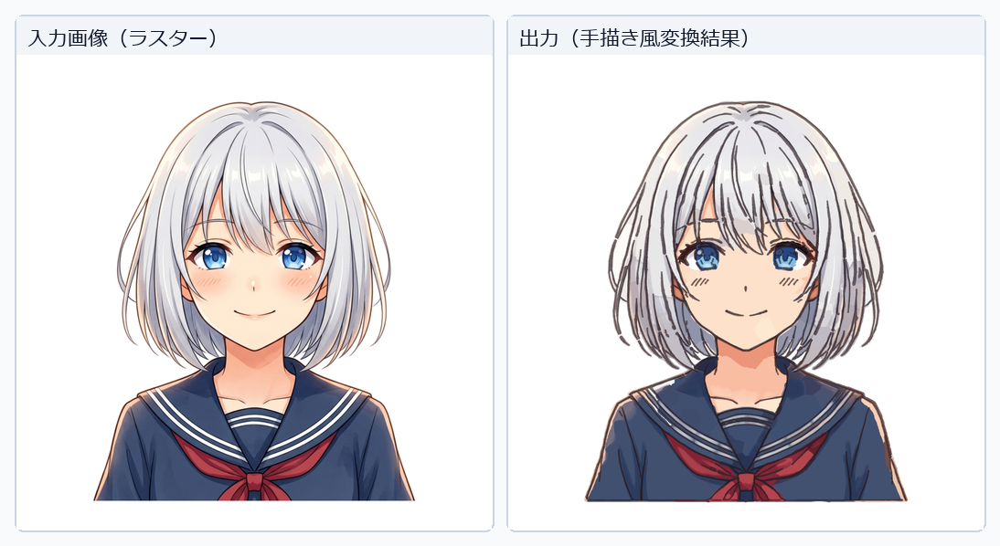
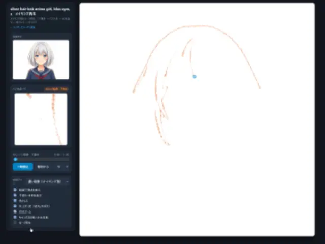
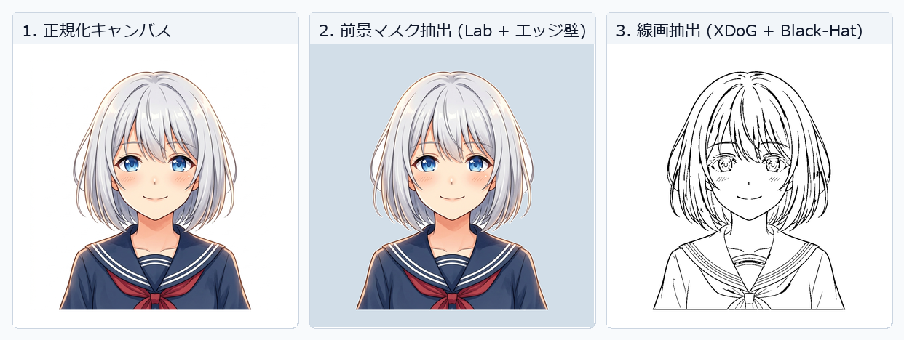
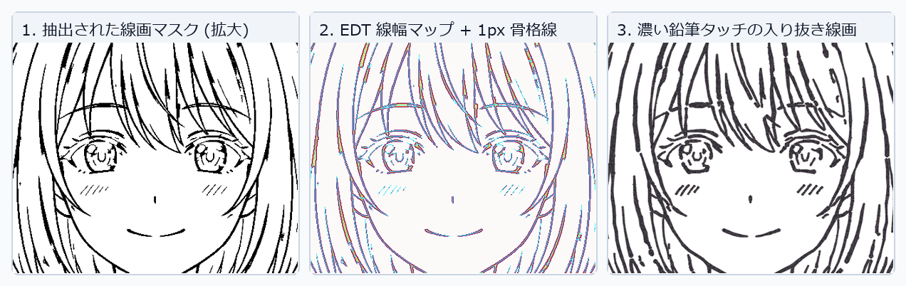
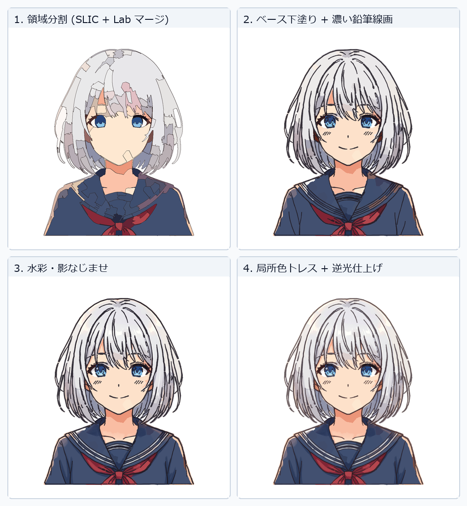
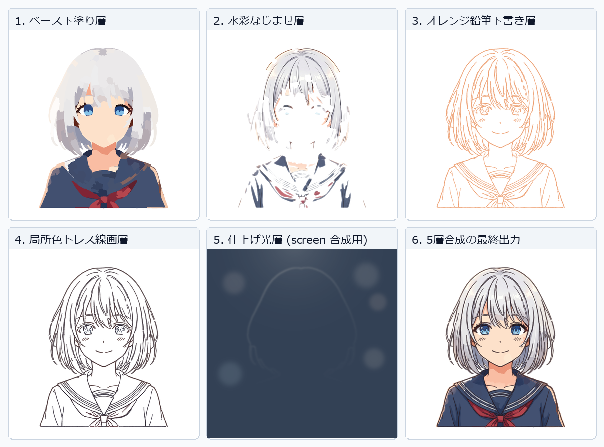
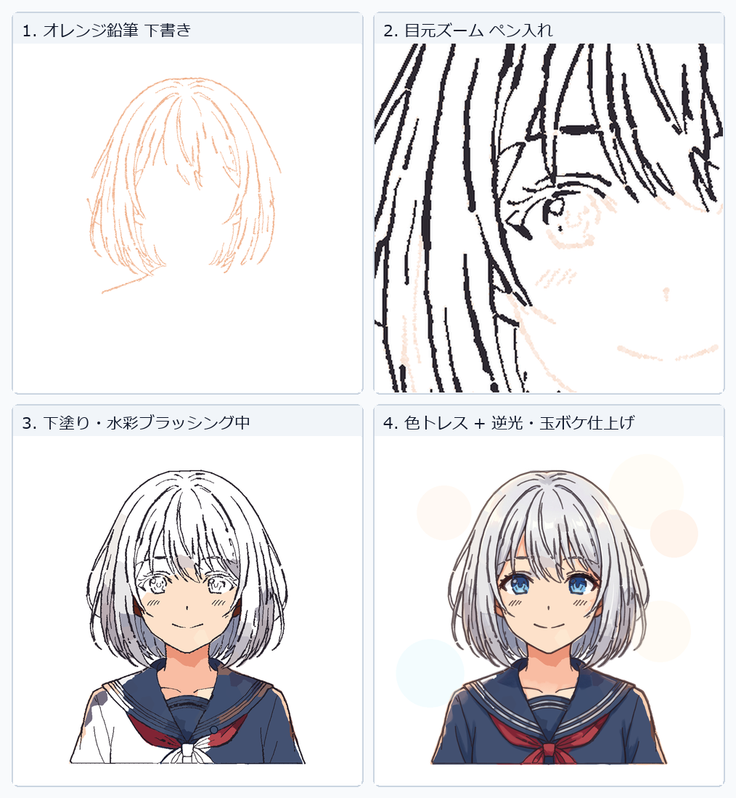
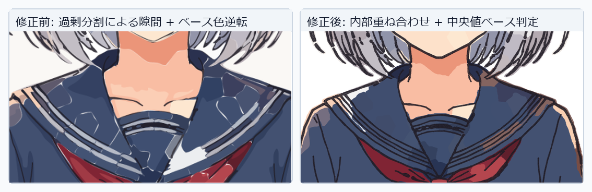

# はじめに

イラストを生成するプログラムの開発を行っていたのですが、クオリティーがイマイチな結果しか出ませんでした。そのとき、こちらで面白いことをやっている方がいらっしゃいました。

https://x.com/masamune_sakaki/status/2125131744991199307

これに触発を受けて、手書きに寄せて再実装させてみることにしました。

# 再実装の指針

1 枚のラスターイラストを編集可能な形式へ変換する際、単純に減色して輪郭をポリゴンで塗りつぶす自動トレースだけでは、境界が硬く均一なベタ面が並ぶだけの見た目になりがちです。線画の太さを後から調整したくても、中心線ではなく「輪郭の帯」になっているため手直しが効きません。

一方で、画像解析で取り出した「中心線＋太さ」や「パーツ別の閉領域」をそのまま硬い塗りつぶしパスとして描くのではなく、「手描き風の質感・水彩グラデーション・局所的な色トレスを乗せるための構造ガイド」として使うアプローチをとると、見た目が一気に自然なイラストへ近づきます。

本記事では、1 枚のラスター画像から線画と色領域を分解したうえで、Python 直接描画による手描き風 PNG・5 層 PSD・フィルタ付き SVG・HTML5 Canvas の作画アニメーションを一貫して生成する技術構成をまとめます。



- 作成工程をそれっぽくアニメーション化したもの(3MB以内に抑えるためにぼけてます)



[https://illustrations.mofon001.workers.dev/trace_player](https://illustrations.mofon001.workers.dev/trace_player)

---

# 変換パイプラインの全体像

手描き風の仕上がりとデータとしての編集性を両立させるには、解析フェーズとレンダリングフェーズを切り分け、中間表現として「中心線＋太さプロファイル」と「閉じた塗り領域」の 2 種類を保持する設計が扱いやすい形でした。

解析側では、XDoG とモルフォロジー演算から中心線と入り抜き幅を計測し、並行して SLIC と線画バリアで色領域と陰影を分解する構成にしました。出力側では同じ中間データを共有しながら、Python 直接描画（PNG / PSD / ORA）、フィルタ付き SVG、HTML5 Canvas 再生の 3 通りへ展開しています。

```html-embed
<div class="ic-flow" role="region" aria-label="手描き風変換パイプラインの全体像">
  <style>
    .ic-flow {
      --bg: #f8fafc;
      --surface: #ffffff;
      --border: #cbd5e1;
      --text: #0f172a;
      --muted: #475569;
      --accent: #0284c7;
      --accent-bg: #e0f2fe;
      --teal: #0d9488;
      --teal-bg: #ccfbf1;
      box-sizing: border-box;
      padding: 14px;
      border-radius: 10px;
      background: var(--bg);
      color: var(--text);
      border: 1px solid var(--border);
      font-family: -apple-system, BlinkMacSystemFont, "Segoe UI", Roboto, sans-serif;
      font-size: 12px;
      line-height: 1.45;
    }
    [data-theme="dark"] .ic-flow {
      --bg: #0f172a;
      --surface: #1e293b;
      --border: #334155;
      --text: #f1f5f9;
      --muted: #cbd5e1;
      --accent: #38bdf8;
      --accent-bg: #0c4a6e;
      --teal: #2dd4bf;
      --teal-bg: #134e4a;
    }
    .ic-flow *, .ic-flow *::before, .ic-flow *::after {
      box-sizing: border-box;
    }
    .ic-flow-head {
      display: flex;
      align-items: center;
      justify-content: space-between;
      gap: 10px;
      margin-bottom: 10px;
      padding: 8px 10px;
      background: var(--surface);
      border: 1px solid var(--border);
      border-radius: 8px;
    }
    .ic-flow-title {
      font-weight: 700;
      font-size: 13px;
    }
    .ic-flow-sub {
      color: var(--muted);
      font-size: 12px;
    }
    .ic-flow-grid {
      display: grid;
      grid-template-columns: 1fr 1fr;
      gap: 10px;
      margin-bottom: 10px;
    }
    .ic-col {
      background: var(--surface);
      border: 1px solid var(--border);
      border-radius: 8px;
      padding: 10px;
      min-width: 0;
      overflow-wrap: anywhere;
    }
    .ic-badge {
      display: inline-block;
      padding: 2px 8px;
      border-radius: 999px;
      font-size: 12px;
      font-weight: 700;
      margin-bottom: 8px;
    }
    .ic-badge-line {
      background: var(--accent-bg);
      color: var(--accent);
    }
    .ic-badge-fill {
      background: var(--teal-bg);
      color: var(--teal);
    }
    .ic-step {
      padding: 6px 8px;
      border-radius: 6px;
      border: 1px solid var(--border);
      background: var(--bg);
      margin-bottom: 6px;
    }
    .ic-step:last-child {
      margin-bottom: 0;
    }
    .ic-step strong {
      display: block;
      font-size: 12px;
    }
    .ic-step span {
      color: var(--muted);
      font-size: 12px;
    }
    .ic-out {
      display: grid;
      grid-template-columns: 1fr 1fr 1fr;
      gap: 8px;
    }
    .ic-out-box {
      background: var(--surface);
      border: 1px solid var(--border);
      border-radius: 8px;
      padding: 8px 10px;
      min-width: 0;
    }
    @media (max-width: 640px) {
      .ic-flow-head {
        flex-direction: column;
        align-items: flex-start;
      }
      .ic-flow-grid, .ic-out {
        grid-template-columns: 1fr;
      }
    }
  </style>
  <div class="ic-flow-head">
    <div class="ic-flow-title">1. 前処理：正規化 &amp; 前景切り抜き</div>
    <div class="ic-flow-sub">正方形キャンバス化 + Lab 距離 + エッジ壁フラッドフィル</div>
  </div>
  <div class="ic-flow-grid">
    <div class="ic-col">
      <div class="ic-badge ic-badge-line">線の解析（ストローク構造）</div>
      <div class="ic-step">
        <strong>XDoG + Black-Hat 二値化</strong>
        <span>主線と鼻・口の細い描線を同時に検出</span>
      </div>
      <div class="ic-step">
        <strong>骨格化 + 距離変換 (EDT)</strong>
        <span>1px 中心線と各点の線幅プロファイルを計測</span>
      </div>
      <div class="ic-step">
        <strong>分岐点分割 + 3次ベジェ近似</strong>
        <span>入り抜き付きの可変幅ベジェ中心線へ変換</span>
      </div>
    </div>
    <div class="ic-col">
      <div class="ic-badge ic-badge-fill">面の解析（領域・陰影構造）</div>
      <div class="ic-step">
        <strong>SLIC + 線画バリア付き統合</strong>
        <span>線を跨がないように同色タイルを結合</span>
      </div>
      <div class="ic-step">
        <strong>Lab KMeans 陰影 &amp; 光源推定</strong>
        <span>中央値基準のベース色と影・ハイライトを抽出</span>
      </div>
      <div class="ic-step">
        <strong>1px 内部膨張 + 輪郭ベジェ化</strong>
        <span>前景内にクランプして境界の隙間を解消</span>
      </div>
    </div>
  </div>
  <div class="ic-out">
    <div class="ic-out-box">
      <strong>Python 直接描画</strong><br />
      <span>5層 RGBA 合成による PNG / PSD / ORA</span>
    </div>
    <div class="ic-out-box">
      <strong>手描き風 SVG</strong><br />
      <span>ゆらぎ・ぼかし・逆光フィルタ付きベクター</span>
    </div>
    <div class="ic-out-box">
      <strong>HTML5 Canvas</strong><br />
      <span>作画順＋目元ズームのメイキング再生</span>
    </div>
  </div>
</div>
```

---

# 前景の切り抜きと線画の抽出

変換の最初のつまずきやすい点は、白い服や白い髪が背景の白と一体化してしまうことです。単純に明度や背景色との色差だけでしきい値処理を行うと、白いセーラー襟やハイライト部分まで背景として削られてしまいます。

## エッジ壁を使ったフラッドフィル

背景切り抜きでは、まずキャンバス外周 4 ピクセルの中央値から背景色を推定し、CIE Lab 空間で背景との色差を計算します。そのうえで Canny エッジ検出で輪郭を 3x3 に少し膨張させた「エッジの壁」を作り、四隅からフラッドフィル（塗りつぶし）を実行する流れです。

線画という境界壁があるおかげで、四隅から流れ込んだ背景判定はキャラクターの白い服や白い髪の中へ侵入できなくなります。バストアップ構図で画像下端が途中で切れている場合は、下端付近の前景スキャン範囲に人工的な壁を補っておくと、服の裾から背景が逆流する事故も防げます。



## XDoG と Black-Hat の組み合わせ

線画の抽出には XDoG（Extended Difference of Gaussians）が定番ですが、XDoG だけだと鼻の点や薄い口元、髪の細い内線がかすれて落ちることがありました。そこで、ガウシアン差分による XDoG に加えて、モルフォロジー演算の Black-Hat（クロージング画像から元画像を引いた差分）を論理和で合成しました。

```python
gray_u8 = cv2.cvtColor(canvas_bgr, cv2.COLOR_BGR2GRAY)
gray = gray_u8.astype(np.float32) / 255.0
g1 = cv2.GaussianBlur(gray, (0, 0), sigmaX=0.8)
g2 = cv2.GaussianBlur(gray, (0, 0), sigmaX=0.8 * 1.6)
dog = g1 - 0.97 * g2

xdog = np.where(dog >= -0.02, 1.0, 1.0 + np.tanh(14.0 * (dog - (-0.02))))
ink_xdog = (xdog < 0.82).astype(np.uint8) * 255

# 細かい暗い線（鼻・口・髪の内線）を Black-Hat で補完
bh_kernel = cv2.getStructuringElement(cv2.MORPH_ELLIPSE, (9, 9))
blackhat = cv2.morphologyEx(gray_u8, cv2.MORPH_BLACKHAT, bh_kernel)
ink_bh = (blackhat > 22).astype(np.uint8) * 255

ink = cv2.bitwise_or(ink_xdog, ink_bh)
```

XDoG 側の `sigma=0.8` と `k=1.6` で太めの主線と強弱を拾い、9x9 楕円カーネルの Black-Hat で局所的に暗い細線を補う仕組みです。最後に前景マスクをわずかに膨張させた領域でマスクし、面積 5 ピクセル未満の孤立ノイズを落とすと、右パネルのようなすっきりした 2 値線画が得られました。

---

# 中心線の抽出と入り抜きベクター化

2 値の線画マスクをそのままベクター化すると、線の「外側と内側の 2 本の輪郭」に囲まれた塗りつぶしパスになり、ブラシの粒子を乗せたり、一筆ずつ描き進めたりしにくくなります。線を「中心線」と「各点の太さ」に分解する工程がここに入ります。

## 骨格化とユークリッド距離変換

線画の 2 値マスクに対して `skimage.morphology.skeletonize` で幅 1 ピクセルの骨格（スケルトン）を取り出し、同時に同じマスクへ `scipy.ndimage.distance_transform_edt` を適用しました。距離変換マップの値は「その画素から線の外側までの最短距離（＝線の半径）」を表しているため、骨格線上の各ピクセル位置で距離マップを参照し、2 倍すれば元の線の太さが手に入ります。



真ん中のパネルでは、線の太さに応じたヒートマップ（細いほど暗く、太いほど明るい色）の中心を、水色の 1 ピクセル骨格線が通っている様子が確認できます。

## 分岐点での分割と 3 次ベジェ化

骨格線には T 字や X 字の交差（8 近傍の隣接ピクセル数が 3 以上）が含まれるため、そのまま 1 本の配列に並べると筆が行き来して破綻してしまいます。そこで、近傍数 3 以上の分岐点と近傍数 1 の端点をノードとみなし、枝ごとに分割して順序付きの点列へ切り出しました。

切り出した点列に対しては、ガウシアン平滑化後の接線角度変化から鋭い角（42 度以上）を検出して分割し、Schneider の最小二乗法による 3 次ベジェフィッティングを適用します。線の太さについては点列に沿った計測値の傾向を解析し、両端が細くなる `tapered_both`、始点のみ細い `tapered_start`、終点のみ細い `tapered_end` といった入り抜きプロファイルへ整理する形です。

この中心線データと太さプロファイルが手元にあれば、SVG 出力時には法線方向へ $\pm w(s)/2$ だけオフセットした閉パス（可変幅リボン）を作れ、手描き風レンダリング時には紙目テクスチャや粒状スタンプを弧長に沿って配置できるようになりました。

---

# 面の領域分割と陰影・ハイライトの分解

線画だけでなく色の面も構造化するため、前景マスク内を色と輪郭に沿って領域分割します。単純にピクセルを KMeans で減色するだけだと、離れたパーツ同士が 1 つの巨大パスにまとまってしまい、パーツ別の塗り分けや描き順制御が効かなくなります。

## 線画をバリアにした SLIC マージ

まずバイラテラルフィルタで微細なノイズやグラデーションの段差を均したうえで、SLIC（Simple Linear Iterative Clustering）によって前景を約 380 個のスーパーピクセルに分割しました。次に隣接するスーパーピクセル同士を Lab 色空間の距離順に統合していきますが、共有境界が線画マスク（バリア）に乗っているペアには強いペナルティを与えて統合を阻止します。

結果として、髪・肌・服・リボンといった線画で区切られたパーツ単位で自然な色の島が残り、120 ピクセル未満の小領域を隣接領域へ吸収すると、左上の図 1 のような整理された領域マップになりました。



## 陰影の分離と光源方向推定

分割した各領域の内部には、アニメ塗りや水彩風の影・ハイライトが含まれています。各領域の内部ピクセル（境界のアンチエイリアス混色を避けるため 2 ピクセル内側に収縮した領域からサンプリング）に対して Lab 空間の輝度分散に応じた $k=1 \sim 3$ の KMeans クラスタリングを行い、ベース色より暗いクラスタを影、明るいクラスタをハイライトとして切り出しました。

あわせて前景全体の輝度勾配 $(\nabla L^*)$ の中央値から 2 次元光源方向を推定しておくと、後段の仕上げ処理で光源側へ逆光ウォッシュを足す際の基準ベクトルとして活用可能です。

---

# 構造をガイドにした手描き風レンダリング

同じ中間データ（線画のストロークと分割済み領域）を使っても、硬い離散ポリゴンのまま描く場合と、手描き風の 5 層合成を行う場合とでは、仕上がりの自然さに大きな差が出ます。

## なぜ手描き風の方が見た目が自然になるのか

従来の単純なベクター変換では、領域の中身を「ベース 1 色＋KMeans の影 1〜2 枚」という離散的な色の段差に圧縮していました。そのため、頬のチークや瞳のグラデーション、髪の柔らかい立体感がポスタリゼーションのような硬い境界になりやすくなります。

手描き風レンダリングでは、抽出した領域輪郭と中心線を「ガイド」として使いながら、以下の 4 つの処理を重ねました。

1. **水彩なじませによる連続階調の復元**: ベース色を塗った上から、領域境界でクリップした内側にガウシアンぼかしマスクを作り、元画像の連続的なグラデーションを水彩レイヤーとして馴染ませる
2. **ピクセル単位の局所色トレス**: パーツ一律の色混ぜではなく、線画のアルファマスク直下にある塗り色と暖色系（`#8B473C`）をピクセルごとにブレンドし、肌の上は肌色寄り、服の上は紺寄りの線にする
3. **濃い鉛筆の紙目質感**: 中心線に沿って微細な濃淡ノイズ（紙目）を乗せることで、骨格化や近似時に生じたわずかな段差を「鉛筆のかすれ」として自然に馴染ませる
4. **逆光と玉ボケの `screen` 合成**: 光源方向からの暖かい光ウォッシュと淡いボケ円を最上層でスクリーン合成し、パーツ間のコントラストを整える

## Python 直接描画による 5 層合成と PSD 出力

こうした表現はブラウザの Canvas 専用ではなく、Pillow + NumPy + OpenCV だけでも同じ品質を直接レンダリングできます。図 5 のように、ベース下塗り・水彩なじませ・オレンジ鉛筆下書き・局所色トレス線画・仕上げ光の 5 枚の RGBA バッファを独立して構築し、最後に重ね合わせる構成です。



たとえば局所色トレスと `screen` 合成のコア部分は、NumPy 配列演算で数行に収まります。

```python
# 1. 局所色トレス：線画ピクセル直下の元画像色 + 暖色トーンをブレンド
blended = ink_rgb * 0.70 + ref_rgb * 0.30
warm_tint = np.array([139.0, 71.0, 60.0], dtype=np.float32)
traced_rgb = np.clip(blended * 0.90 + warm_tint * 0.10, 0, 255).astype(np.uint8)

# 2. 仕上げ光：最上層を screen 合成で重ねる
dst_f = comp_rgb.astype(np.float32) / 255.0
src_f = finish_rgb.astype(np.float32) / 255.0
src_a = finish_alpha.astype(np.float32) / 255.0
out_rgb = np.clip((1.0 - (1.0 - dst_f) * (1.0 - src_f * src_a)) * 255.0, 0, 255)
```

各層が独立した RGBA 配列として手に入るため、PNG として統合画像を保存するだけでなく、5 層のままペイントソフト互換の PSD（仕上げ光は `scrn` 合成モード）や OpenRaster（`.ora`）へそのまま書き出して後から手修正することも可能になりました。

## 純粋な SVG で手描き感を出すための工夫

ベクターのまま拡大縮小や編集ができる SVG 出力についても、単色のベタ塗り・硬い線画のままでは手描き感が出にくい部分がありました。そこで SVG 側には `<defs>` 内に次のフィルタとグラデーションを定義し、編集可能性を保ったまま質感だけを寄せています。

```xml
<filter id="handdrawn_pencil" x="-5%" y="-5%" width="110%" height="110%">
  <feTurbulence type="fractalNoise" baseFrequency="0.035" numOctaves="2" seed="3" result="noise" />
  <feDisplacementMap in="SourceGraphic" in2="noise" scale="1.35" />
</filter>
<filter id="handdrawn_soft_shadow" x="-15%" y="-15%" width="130%" height="130%">
  <feGaussianBlur stdDeviation="2.6" />
</filter>
```

線画グループには `handdrawn_pencil` を当てて微細な輪郭のゆらぎを付け、KMeans で抽出した影パスには `handdrawn_soft_shadow` で柔らかい境界を持たせました。最上層のポストエフェクトレイヤーには光源位置に応じた `<radialGradient>` と玉ボケ円を `mix-blend-mode: screen` で配置し、SVG 単体でも光の空気感が出るように整えています。

---

# HTML5 Canvas による作画工程のアニメーション再生

静的な画像や SVG に加えて、解析した中心線と塗り領域を時間軸へ配置すれば、人間が描き進めるようなメイキング風アニメーションも生成できます。配列の先頭から機械的に描画するとペンがあちこちへ飛んで不自然になるため、タイムライン生成と描画ループの両面で調整を入れました。

## 描き順の整列とカメラワーク

ストロークはまず「頭頂・髪 → 顔の輪郭 → 左目・左眉 → 右目・右眉 → 鼻・口 → 首・体・服」の意味的なグループ順に並べ、同じグループ内では最も上にある線から開始して、直前の終点から最も近い端点を持つ線へ貪欲に連結します（終点側が近ければ点列と幅配列を反転します）。

さらに作画の所作に近づけるため、目元のペン入れ区間だけ該当バウンディングボックスへ 2.0〜3.6 倍にズームインし、ペン入れ全体には `-10°`〜`+8°` のわずかなキャンバス回転と、工程区切りでの「左右反転チェック」を入れました。

```html-embed
<div class="ic-anim" role="region" aria-label="Canvas メイキング再生のフェーズとオフスクリーン合成構造">
  <style>
    .ic-anim {
      --bg: #f8fafc;
      --surface: #ffffff;
      --border: #cbd5e1;
      --text: #0f172a;
      --muted: #475569;
      --pencil: #ea580c;
      --pencil-bg: #ffedd5;
      --ink: #0284c7;
      --ink-bg: #e0f2fe;
      --fill: #059669;
      --fill-bg: #d1fae5;
      --wc: #7c3aed;
      --wc-bg: #ede9fe;
      --fin: #d97706;
      --fin-bg: #fef3c7;
      box-sizing: border-box;
      padding: 14px;
      border-radius: 10px;
      background: var(--bg);
      color: var(--text);
      border: 1px solid var(--border);
      font-family: -apple-system, BlinkMacSystemFont, "Segoe UI", Roboto, sans-serif;
      font-size: 12px;
      line-height: 1.45;
    }
    [data-theme="dark"] .ic-anim {
      --bg: #0f172a;
      --surface: #1e293b;
      --border: #334155;
      --text: #f1f5f9;
      --muted: #cbd5e1;
      --pencil: #fb923c;
      --pencil-bg: #431407;
      --ink: #38bdf8;
      --ink-bg: #0c4a6e;
      --fill: #34d399;
      --fill-bg: #064e3b;
      --wc: #c084fc;
      --wc-bg: #3b0764;
      --fin: #fbbf24;
      --fin-bg: #451a03;
    }
    .ic-anim *, .ic-anim *::before, .ic-anim *::after {
      box-sizing: border-box;
    }
    .ic-anim-wrap {
      display: grid;
      grid-template-columns: 1.2fr 1fr;
      gap: 12px;
      align-items: start;
    }
    .ic-card {
      background: var(--surface);
      border: 1px solid var(--border);
      border-radius: 8px;
      padding: 10px;
      min-width: 0;
    }
    .ic-card-title {
      font-weight: 700;
      font-size: 13px;
      margin-bottom: 8px;
    }
    .ic-phase-list {
      display: flex;
      flex-direction: column;
      gap: 6px;
    }
    .ic-phase {
      display: flex;
      justify-content: space-between;
      align-items: center;
      gap: 8px;
      padding: 5px 8px;
      border-radius: 6px;
      border: 1px solid var(--border);
      background: var(--bg);
    }
    .ic-tag {
      font-size: 12px;
      font-weight: 700;
      padding: 1px 7px;
      border-radius: 999px;
      white-space: nowrap;
    }
    .t-pen { background: var(--pencil-bg); color: var(--pencil); }
    .t-ink { background: var(--ink-bg); color: var(--ink); }
    .t-fill { background: var(--fill-bg); color: var(--fill); }
    .t-wc { background: var(--wc-bg); color: var(--wc); }
    .t-fin { background: var(--fin-bg); color: var(--fin); }
    .ic-layer {
      padding: 6px 8px;
      border-radius: 6px;
      border: 1px dashed var(--border);
      margin-bottom: 6px;
      background: var(--bg);
    }
    .ic-layer:last-child {
      margin-bottom: 0;
    }
    .ic-layer small {
      display: block;
      color: var(--muted);
      font-size: 12px;
    }
    @media (max-width: 640px) {
      .ic-anim-wrap {
        grid-template-columns: 1fr;
      }
    }
  </style>
  <div class="ic-anim-wrap">
    <div class="ic-card">
      <div class="ic-card-title">タイムライン進行（再生順）</div>
      <div class="ic-phase-list">
        <div class="ic-phase">
          <span>1. オレンジ鉛筆 下書き</span>
          <span class="ic-tag t-pen">粒子ブラシ</span>
        </div>
        <div class="ic-phase">
          <span>2. ペン入れ（頭・目元ズーム・体）</span>
          <span class="ic-tag t-ink">傾き / 拡大</span>
        </div>
        <div class="ic-phase">
          <span>3. 下塗り（斜めジグザグ太筆）</span>
          <span class="ic-tag t-fill">輪郭クリップ</span>
        </div>
        <div class="ic-phase">
          <span>4. 水彩なじませ（放射状ソフトブラシ）</span>
          <span class="ic-tag t-wc">元画像合成</span>
        </div>
        <div class="ic-phase">
          <span>5. 色トレス ＆ 逆光・玉ボケ仕上げ</span>
          <span class="ic-tag t-fin">screen 合成</span>
        </div>
      </div>
    </div>
    <div class="ic-card">
      <div class="ic-card-title">合成順（上から下へ重ねる構成）</div>
      <div class="ic-layer">
        <strong>最上層：光オーバーレイ</strong>
        <small>screen 合成の逆光グラデと玉ボケ</small>
      </div>
      <div class="ic-layer">
        <strong>線画：ink / colorTrace Canvas</strong>
        <small>source-atop で周囲色と暖色を馴染ませる</small>
      </div>
      <div class="ic-layer">
        <strong>ガイド：pencil Canvas（薄め）</strong>
        <small>下書き完了後は不透明度を下げて下敷きに</small>
      </div>
      <div class="ic-layer">
        <strong>彩色：watercolor → fill Canvas</strong>
        <small>線画の下側で clip('evenodd') 描画</small>
      </div>
    </div>
  </div>
</div>
```

## ローカルファイルでも安全に動く合成テクニック

HTML5 Canvas で元画像のグラデーションを水彩ブラシで馴染ませる際、`getImageData()` でピクセル配列を直接読み出す実装にすると、ローカル環境で HTML を `file://` スキームで開いたときにブラウザの同一オリジン制約（Canvas tainting）で `SecurityError` が発生してしまいます。

そこで、ピクセルの直接読み出しは一切使わず、`globalCompositeOperation` だけでオフスクリーン合成を組みました。

```javascript
// 1. ソフトブラシのアルファマスクを一時 Canvas に描く
wcScratchCtx.globalCompositeOperation = 'source-over';
wcScratchCtx.arc(p.x, p.y, radius, 0, Math.PI * 2);
wcScratchCtx.fill(); // 中心 alpha=0.42 → 外側 0.0 の放射グラデーション

// 2. source-in で元画像の該当範囲だけをブラシ形状で切り抜く
wcScratchCtx.globalCompositeOperation = 'source-in';
wcScratchCtx.drawImage(normImg, bx, by, bw, bh, bx, by, bw, bh);

// 3. パーツの輪郭 Path2D でクリップして水彩レイヤーへ転写
wcCtx.clip(fl._clipPath, 'evenodd');
wcCtx.drawImage(wcScratchCanvas, bx, by, bw, bh, bx, by, bw, bh);
```

色トレスも同様に、線画を描いた `colorTraceCanvas` に対して `globalCompositeOperation = 'source-atop'` で元画像と暖色トーンを薄く重ねています。描画ループ自体も「前回フレーム時刻から現在時刻までの差分区間だけ」オフスクリーン Canvas に追記する方式にしたところ、800 本以上のストロークがあっても 60fps で滑らかに再生できました。



---

# 実装して分かった変換時の落とし穴と対策

一通りの変換処理が動くようになった後、実際のキャラクター画像（紺色のセーラー服や毛並みの陰影など）を流してみると、見た目を大きく損ねる不具合がいくつか見つかりました。原因はいずれもアルゴリズムの境界条件にありました。



## 1. 服の内部にできる多角形の白い隙間

最初の版では、左側の画像のように紺色のセーラー服や襟の中に、細かいヒビ割れのような白い隙間が多数残りました。原因は 2 つ重なっていました。

1 つ目は、SLIC スーパーピクセルの統合条件です。`bar_ratio * 24.0` という線画ペナルティを常に足していたため、服のわずかなシワや陰影のエッジに少し線画マスクが掛かっただけで同じ紺色のタイル同士が統合されず、細切れのまま残ってしまっていました。境界上の線画重複率 `bar_ratio < 0.22` の軽微な引っ掛かりは無視して統合するよう条件を緩めたところ、不要なモザイク分割が解消しています。

2 つ目は、ベジェ近似による境界の痩せです。領域ごとに独立して輪郭を抜き、`max_error=1.8` で平滑化していたため、隣接する領域の曲線同士が互いに内向きへ 1〜2 ピクセル引っ込み、下地の白が覗いていました。各領域のマスクを**前景シルエットの内側にクランプした状態で 1 ピクセルだけ膨張**（`cv2.dilate(mask, 3x3) & fg_union`）してから `max_error=0.9` で輪郭抽出し、さらにベース塗り時に 2 ピクセルの同色境界トラッピングをかけることで、外側の輪郭は膨らませずに内部の隙間だけを塞げました。

## 2. 襟の一部が真っ白に反転する現象

左側の画像の右襟下に、紺色であるべき部分が白い三角の塊として塗られている箇所があります。これは KMeans（`k=3`）でベースカラーを判定する際の落とし穴でした。

ベースカラーの判定処理では当初、最もピクセル数が多いクラスタ（`argmax(counts)`）をベースカラーとしていました。ところが、襟の領域の中に「濃い紺（約 33%）・やや明るい紺（約 32%）・白い2本ライン（約 35%）」が混在すると、本来は 65% を占める紺色が 2 つのクラスタに割れた結果、35% の白クラスタが単独最大となってしまい、領域全体のベースカラーが白に反転してしまいました。

対策として、最大クラスタの割合が明確な過半数（55% 以上）に届かない場合は `argmax` を信頼せず、領域全体のピクセル中央値（`median_lab`）に最も近い主要クラスタをベースカラーに選ぶロジックへ変更しました。修正後の図右側では、紺色の襟として正しく塗られているのが確認できます。

## 3. 線画と塗りの座標系ズレ

別系統のレイヤー分解と数学的解析の結果を組み合わせて描画する際、線画は正規化キャンバス基準（`x=[110, 905]`）から取り、塗りは別経路で切り出したパーツ輪郭（`x=[24, 830]`）から取った結果、塗りが左へ約 86 ピクセルずれたまま単色で塗られてしまうケースがありました。線画を解析座標系から採用したときは、塗り領域も同じ解析座標系の領域分割マップから引くように抽出ソースを揃えたところ、ピクセル単位で位置が一致しました。

---

# おわりに

1 枚のラスターイラストをそのまま硬い塗りつぶしパスへ変換するのではなく、「中心線＋太さ」と「線画バリア付きの色領域」を構造ガイドとして取り出し、水彩馴染ませ・濃い鉛筆質感・局所色トレス・逆光仕上げを載せることで、手描きに近い自然な出力とレイヤー編集性を両立できました。

Python 側の RGBA 直接描画、フィルタ付き SVG、HTML5 Canvas 再生のすべてが同じ中間データ（タイムラインと領域構造）を参照しているため、静止画 PNG・PSD・SVG・アニメーション再生の間で見た目のズレが出にくい点も実運用上の利点になっています。
