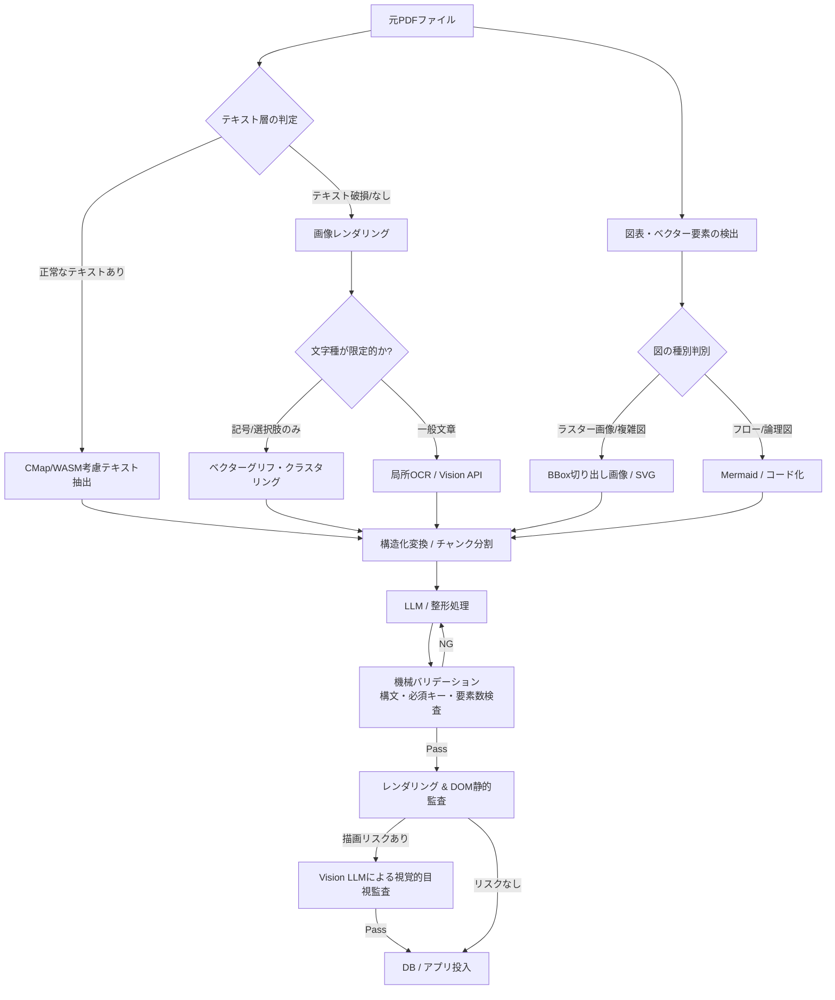
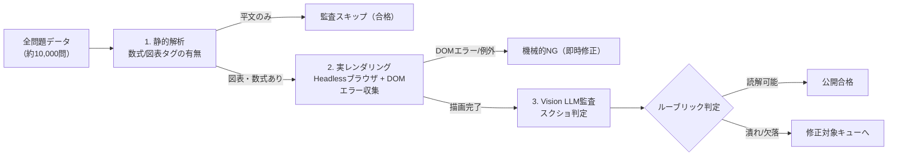

## はじめに

スキャン帳票、試験問題、学術論文、社内規定といったPDFドキュメントを、Webアプリケーションやデータベースに取り込むためにMarkdownやJSONへ変換する案件は珍しくありません。

最近はマルチモーダルLLMやクラウドOCR APIの精度が上がり、ファイルをそのまま投げれば解決するように見えます。しかし、数百ページから数万件規模のPDFを処理しようとすると、すぐに別の問題にぶつかります。

全ページを高解像度画像化してVision APIに投げ続けるとAPI費用と実行時間が膨らみます。また、PDF内部にテキスト層が残っているにもかかわらず、文字化けや欠落のせいでスキャン画像と誤認するケースもあります。

さらに厄介なのが図表の扱いです。PDF内の図は単なる画像とは限らず、ベクターパス、埋め込みフォント、罫線が組み合わさって描画されています。これらをどう切り出してWeb上で再現するか、そして数式やダイアグラムの表示崩れをどう検知するかまで含めて設計しないと、データ化のパイプラインは破綻します。

約1万問（200回分超）の情報処理技術者試験の試験PDFを取り込み、MarkdownとPostgreSQLへ展開した経験から、個別システムに依存しない汎用的なPDF構造化・OCRパイプラインの設計手順を整理しました。

---

## 全体像: 多層防御のパイプライン

パイプラインの基本方針は、最初から重い処理に頼らないことです。安価で高速なルールベース処理で大半を片付け、判断が難しい領域だけをLLMやVision、人間の確認に回す多段構成をとります。



全体の流れは、PDFのテキスト層判定、図表の抽出と表現形式の選定、文字認識の最適化、バリデーションと視覚監査の4段階に分かれます。

---

## 1. PDFテキスト層の落とし穴

PDFからテキストを抽出する際、ライブラリの既定値のまま処理すると、テキスト層が存在するのに空文字が返ってきたり、文字化けを起こすトラブルが起きます。その結果、本来不要な画像OCRに回してしまい、コストと精度の両方を落とすことになります。

### CMap未指定による文字欠落

日本語PDFのフォントは、文字コードとUnicodeを紐付けるCMap（Character Map）を参照して処理されます。
Node.js環境（pdfjsなど）でCMapファイルのパスを明示的に渡していないと、一部の日本語グリフが読み飛ばされ、テキストが存在しないものとして扱われます。

```typescript
import * as pdfjs from 'pdfjs-dist/legacy/build/pdf.mjs';
import path from 'path';

const CMAP_URL = path.join(process.cwd(), 'node_modules/pdfjs-dist/cmaps/');
const STANDARD_FONT_DATA_URL = path.join(
  process.cwd(),
  'node_modules/pdfjs-dist/standard_fonts/'
);

const loadingTask = pdfjs.getDocument({
  data: new Uint8Array(pdfBuffer),
  cMapUrl: CMAP_URL,
  cMapPacked: true,
  standardFontDataUrl: STANDARD_FONT_DATA_URL,
});
```

実際に扱ったドキュメントでも、テキスト層なしと判定されていたファイルの大部分はCMapの未設定が原因でした。設定を補うだけで、OCRを使わずに完全なテキストが得られるケースは少なくありません。

### 特殊圧縮形式とWASMデコーダ

古い文書やスキャン混在のPDFでは、白黒画像に `CCITTFaxDecode` (G4) や `JBIG2` 圧縮が使われている場合があります。
pdfjsなどでページ画像を生成する際、デコード用WASMモジュール（`jbig2.wasm` など）の参照先が抜けていると、画像を含むページが真っ白のままレンダリングされる現象が生じます。画像化スクリプトには `wasmUrl` を確実に設定しておく必要があります。

### 読み順の不一致（列優先 vs 行優先）

PDF内部に保持されているテキストオブジェクトの並び順は、視覚的なレイアウト（上から下、左から右）とは必ずしも一致しません。

2段組の文書や表形式のページでは、テキストストリーム上だけ先に右列の文字が連続して並び、その後に左列の文字が現れるといった現象が起きます。単純な正規表現でパースしようとすると、見出しと本文の対応関係が入れ替わってしまいます。
文字オブジェクトの `x, y` 座標を保持し、Y座標の近さで行をまとめ、行内をX座標順に並べ替える幾何学的なソート処理を前段に挟む必要があります。

---

## 2. 図表の解析とWeb向け再現手法

PDFに含まれる図表をどう処理するかは、テキスト抽出以上に設計の差が出ます。PDFの図は単一の画像ファイルとして埋め込まれているとは限らず、ベクターパス、テキスト、ラスター画像が同じ座標に重ね合わされていることが多いためです。

### 図領域の検出と切り出し

PDFから図を取り出すアプローチには、大きく分けてベクターオブジェクトの走査と、座標指定による画像クロップの2通りがあります。

PDF内部の描画命令（ストローク、塗りつぶし、曲線パス）を解析し、パスが密集しているバウンディングボックス（BBox）を自動検出する方法は、余白の少ない図をきれいに拾うのに向いています。
一方で、周囲のキャプション（「図1-2」「[注]」など）を含めて切り出したい場合や、複数のベクターオブジェクトが離れて配置されている図では、テキストブロックの位置を手がかりに領域を決定し、ページ画像から矩形切り出し（クロップ）を行うほうが安定します。

```typescript
// 座標指定による領域クロップ処理の例（Sharp等の画像処理ライブラリを併用）
import sharp from 'sharp';

interface BoundingBox {
  left: number;
  top: number;
  width: number;
  height: number;
}

export async function cropFigure(
  pageImagePath: string,
  bbox: BoundingBox,
  outputPath: string
): Promise<void> {
  await sharp(pageImagePath)
    .extract({
      left: Math.round(bbox.left),
      top: Math.round(bbox.top),
      width: Math.round(bbox.width),
      height: Math.round(bbox.height),
    })
    .png()
    .toFile(outputPath);
}
```

### 表現形式の使い分け

切り出した図をそのまま画像としてWebアプリに載せると、ダークモード対応が難しかったり、通信量がかさむデメリットがあります。図の性質に応じて出力形式を使い分けます。

- フローチャートやシーケンス図:
  構造が明確な論理図は、LLMを使ってMermaid記法へ変換します。テキスト情報として保持できるため検索性も維持されます。
- 単純な表や枠組み:
  Markdownのテーブル記法、またはコードブロック（svgbobなど）に落とし込みます。
- 幾何図形・ベン図・精密なグラフ:
  Mermaidでは表現しきれない曲線や塗りつぶし領域を持つ図は、無理にコード化しようとすると形状が崩れます。この場合は切り出したラスター画像（PNG/WebP）を維持するか、SVGパスとして直接書き出します。

### 図の変換で踏みやすいトラブル

図をコードやSVGに変換する過程では、特有の落とし穴がいくつかあります。

1つ目は、図の過剰な再解釈です。
原典の図が単なる「下線付きのテキスト」であるにもかかわらず、LLMが気を利かせてER図や複雑なクラス図に作り変えてしまい、元の意味から乖離してしまう事例がありました。見た目を派手にするのではなく、原典が伝えている情報の粒度を保つことが求められます。

2つ目は、Web側サニタイザーによる描画の破壊です。
数式やインラインSVGをレンダリングする際、フロントエンドのHTMLサニタイザー（DOMPurify等）の設定によって `<clipPath>` や一部の属性が除去され、図の一部が欠けてしまう現象が起こります。アプリ側の許可タグ・属性の規約と、生成側の出力形式を事前に擦り合わせておく必要があります。

---

## 3. 文字認識・OCRの最適化

テキスト層が存在せず、真にスキャン画像のみで構成されているページに対してはOCRを適用します。ここでも全ページをVision APIに投げるのではなく、抽出対象の性質に応じた工夫が効きます。

### ベクターグリフ・クラスタリング

マークシートの解答番号や、選択肢の先頭記号（ア・イ・ウ・エ、A・B・Cなど）のように、出現する文字種が限られている領域では、一般的なOCRエンジンを使わない選択肢もあります。

PDFから抽出したグリフの外形パスや、切り出した高解像度画像のピクセル差分をもとにクラスタリングを行います。

```
[切り出された未知の記号画像]
       ↓ (k-means / 階層的クラスタリング)
  クラスタ1: 80件（同一形状） → 代表画像を1度だけ「ア」と確認
  クラスタ2: 80件（同一形状） → 代表画像を1度だけ「イ」と確認
  クラスタ3: 80件（同一形状） → 代表画像を1度だけ「ウ」と確認
  クラスタ4: 80件（同一形状） → 代表画像を1度だけ「エ」と確認
```

この手法を使うと、OCRでありがちな「エ」と「工」の誤読や、「1」と「l」の混同といった事故を避けられます。また、1試験あたり80回文字を目視する代わりに、分類されたクラスタの代表画像4枚をチェックするだけで済むため、確認作業の負荷も大幅に下がります。

---

## 4. 構造化とチャンク処理

テキストと図表の抽出が完了したら、Markdownなどの構造化データへ組み立てます。

長大なドキュメント全体を1つのコンテキストとしてLLMに渡すと、途中の記述が省略されたり、出力トークンの上限に達するリスクが高まります。章ごとや問題番号ごと（10問単位など）の論理的なチャンクに分割し、独立して処理できるようにします。

出力形式にはフロントマター付きMarkdownを採用し、スキーマを厳格に定めます。

```markdown
## 問 1

```yaml
answer: ア
genre: テクノロジ系
topic: ネットワーク
```

問題文テキスト...

### 選択肢
- ア: ...
- イ: ...
- ウ: ...
- エ: ...

### 解説
解説テキスト...
---
```

結合処理を行う前に、TypeScriptなどのコードで自動バリデーションを実施します。

```typescript
export function validateChunk(markdown: string): ValidationResult {
  const questions = parseQuestions(markdown);
  const errors: string[] = [];

  for (const q of questions) {
    if (!q.meta.answer) {
      errors.push(`Q${q.id}: 解答が未定義です`);
    }
    if (q.choices.length !== 4) {
      errors.push(`Q${q.id}: 選択肢数が4ではありません（実測: ${q.choices.length}件）`);
    }

    const labels = q.choices.map(c => c.label);
    const validAnswers = q.meta.answer.split('/');
    for (const ans of validAnswers) {
      if (!labels.includes(ans)) {
        errors.push(`Q${q.id}: 指定解答 [${ans}] が選択肢一覧に見つかりません`);
      }
    }
  }

  return { valid: errors.length === 0, errors };
}
```

この段階で必須フィールドの欠落や選択肢数の過不足を弾くことで、不正なデータがDBに書き込まれるのを防ぎます。

---

## 5. レンダリング監査と視覚的検証

構文テストを通過しても、実際にブラウザ上で意図通りに読めるかどうかは担保されません。特に数式や外部ダイアグラム描画ライブラリを組み合わせる場合、スタイルの競合や描画領域の計算ミスが発生しやすくなります。

### 実際に遭遇した描画の不具合

数式表示（KaTeX）のバージョン競合によって、論理否定の上線 `\overline{A}` のスタイルクラス名が変わり、線の太さが0pxになって正解と不正解の選択肢が見た目上区別できなくなる事象がありました。
また、Mermaidのシーケンス図に設定された `useMaxWidth: true` が親要素のCSSと干渉し、図全体の幅が300pxに強制縮小されてラベルの文字が潰れるトラブルも発生しました。
Markdown内のインデントの乱れが原因で、パーサーがリストの終了と誤認し、選択肢の一部が表示されなくなるケースも見られました。

### 3段階の視覚的監査

数万件規模の全画面を人間がチェックしたり、全件のスクリーンショットをVision LLMに送るのは現実的ではありません。リスク要素に応じた3段階のフィルタリングを設けます。



1. 静的解析:
   本文を走査し、Mermaid、KaTeX、インラインSVGなど、表示崩れのリスクがあるタグを含まない平文データをふるい落とします。多くのデータはこの段階で監査をスキップできます。
2. 実レンダリングとDOM検査:
   Headless Chromeで実際にページを描画し、コンソールエラーの発生有無や、Mermaidのエラー要素の出現を監視します。また、レンダリング後の要素幅が極端に狭くなっていないか（縮退の有無）を機械的にチェックします。
3. Vision LLMによるスクリーンショット判定:
   前段を通過した「崩れる可能性のある図表」に絞って要素のスクリーンショットを撮影し、マルチモーダルLLMに渡して判読可能性を評価させます。

この多層チェックにより、Vision APIの呼び出しを全体の10〜15%程度に抑えつつ、利用者に影響する重大な描画崩れを効率的に検出できます。

---

## 付録: 登場したライブラリと役割

本文で触れた処理を、実際に担った代表的なライブラリと対応付けておきます。バージョンの組み合わせが描画不具合の原因になることもあるため、選定時はセットで確認するのが無難です。

| 領域 | ライブラリ | 役割 |
| --- | --- | --- |
| PDFテキスト抽出 | pdfjs-dist | テキスト層の抽出。`cMapUrl`・`standardFontDataUrl` の指定が日本語欠落対策の要 |
| PDF画像化 | pdfjs-dist（直接描画） | ページレンダリング。G4/JBIG2混在時は `wasmUrl` が必須 |
| 画像クロップ | sharp | 図領域の矩形切り出し。高速・省メモリ |
| 一時レンダリング | PyMuPDF | 日本語豆腐化の回避用に一時利用 |
| Markdown解析 | remark系（remark-gfm / remark-math / remark-frontmatter） | GFM表・数式・フロントマターの構文解析 |
| Markdown描画 | react-markdown | Reactでの描画土台 |
| HTMLサニタイズ | rehype-sanitize | 許可タグ・属性の規約管理。SVG系の許可設定が図再現の可否を決める |
| 数式描画 | rehype-katex / KaTeX | `\overline` 等の数式描画。**レンダラ内蔵版とCSSのバージョン一致が必須**（不一致でバーが0px化した実例あり） |
| 論理図 | Mermaid | フロー・シーケンス・クラス図のコード化。`useMaxWidth` と親CSSの干渉に注意 |
| ASCII図 | remark-svgbob | アスキーアートのSVG化。CJKは全角2桁換算で行幅を揃える必要あり |
| グラフ | Vega-Lite（react-vega） | 散布図等の描画。非同期のため監査時は描画完了待ちが必要 |
| DB | Drizzle ORM / PostgreSQL | Markdown→テーブルの冪等upsert。ファイル指定投入で対象限定 |
| 描画監査 | Headlessブラウザ（Playwright等） | 実描画＋コンソール/DOMエラー収集 |
| テスト | Vitest | ライブラリ更新時の退行検知 |

## おわりに

PDFの取り込みと構造化は、一見するとツールを順に実行するだけの作業に見えます。しかし実務規模になると、PDFの内部構造、フォント埋め込み、図表の表現形式、そしてフロントエンドの描画系との不整合が次々と表面化します。

最初からすべてをAIに任せるのではなく、ルールベースで処理できる箇所、コードで検証できる箇所を固め、要所だけをLLMや視覚モデルで補う構成にすることが、大量のドキュメントを安定して処理するための現実的なアプローチになります。
