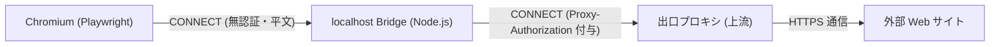

# Meta の Museとは

https://muse.ai/ は、米Meta社が提供する常駐・自律型のパーソナルAIエージェントサービスです。

従来の質問応答型チャットボットとは異なり、ユーザーが与えた目標（ゴール）に対して「自律的に計画を立て、バックグラウンドで作業を実行する」点が最大の特徴です。Webブラウザ（[muse.ai](https://muse.ai/)）やモバイルアプリから利用できます。

### 1. 「答える」から「代行する」エージェントへ
従来のAIチャットボットは「プロンプトに対してテキストで回答する」という一問一答が中心でした。これに対し、muse.ai は以下のような実作業をユーザーの代わりに自律実行します。

* Webブラウジング・情報収集: 指定した条件に基づく製品・技術ドキュメントの比較やリサーチ
* スケジュール・メール調整: GmailやGoogleカレンダーと連携したアポイント調整や下書き作成
* オンライン予約・購買支援: レストラン予約や商品の価格監視（決済や送信など重要アクションはユーザーの承認制）

### 2. クラウド常駐とバックグラウンド処理（Muse Secure VM）
muse.ai では、ユーザーごとに隔離された専用の仮想マシン（Muse Secure VM）がクラウド上に用意されます。
ユーザーがPCを閉じたりブラウザを離脱しても、AIエージェントはクラウド上でタスクを継続実行します。完了時やユーザーの判断・承認が必要になったタイミングでプッシュ通知が届く仕組みになっています。

### 3. コネクターによる外部サービス連携
InstagramやFacebookといったMetaのエコシステムはもちろん、Google Workspace（Gmail、カレンダー）や各種Webサービスとセキュアに連携できます。開発や日々の業務におけるマルチタスクを肩代わりし、作業効率を引き上げるパートナーとして機能します。

---

メールの整理が出来たとかの報告は他の方に任せて、ここではアプリケーション開発が進められるかを検証します。

# 開発環境のスペック

Muse のバックエンド（実行サンドボックス・仮想環境）でプログラムを実行した際の実測スペックは以下の通りです。

| 項目 | スペック / 詳細 |
| :--- | :--- |
| CPU | 2 vCPU（AMD EPYC 9D25、x86_64） |
| メモリ | 約 8GB（OS上では 7.7GiB、スワップなし） |
| 永続ストレージ | 150GB（ホーム領域、実測時約148GB空き） |
| ルート領域 | 7.5GB（OSや一時的な実行環境用） |
| OS | Ubuntu 24.04.5 LTS |
| カーネル | Linux 7.0.0-39 |
| GPU | なし（NVIDIA GPUは未検出） |
| 主なランタイム | Python 3.12.3 / Node.js 24.22.1 |

CPUにはAMD EPYCが割り当てられており、GPUこそ非搭載ですが、Web開発やスクリプト実行、API連携などの一般的なタスクをバックグラウンドで処理するには十分なスペックとストレージ容量が確保されています。

# 使用されるLLM

muse.ai のバックエンドでは、Meta が開発する「Muse モデルファミリー」から主に以下の2種類の LLM が稼働しています。

| モデル名 | 位置づけ | 主な役割・特徴 |
| :--- | :--- | :--- |
| Muse Spark | 無料プラン向け基本モデル | 日常的な対話、軽量なコーディング支援、一般的なタスク処理などを高速かつ安定してこなす標準モデル。 |
| Muse Wonder | 有料プラン向け上位モデル | より高度な推論能力を備えたフラグシップモデル。複雑なアプリケーション構築、長期的なバックグラウンド作業、定期実行タスクなどを強力にサポート。 |

### モデルの割り当て仕様
ChatGPT などの一般的なチャットサービスのように、UI上のドロップダウンからユーザーが手動でモデルを切り替える設定は用意されていません。

契約しているプラン（無料/有料）やアカウントの状態、実行するタスクの種別に応じて、システム側が自動的に最適なモデルを割り当てる仕様になっています。開発作業を行うにあたっては、複雑な自律タスクを安定して回すために有料プラン（Muse Wonder の割り当て）が有利になる場面もありますが、基本的なスクリプト実行やコード生成は無料枠の Muse Spark でも十分にこなせる実力を備えています。

# 通信のアクセス制限について

サンドボックス化されたクラウドVM環境やセキュアな開発環境では、不正な外部通信やデータ流出を防ぐために強固なアクセス制限が敷かれています。

本環境で Playwright や Puppeteer などのヘッドレスブラウザ（Chromium）を動かそうとした際、「`curl` では外部と通信できるのに、Chromium ではすべてのサイトで `ERR_TUNNEL_CONNECTION_FAILED` になり全滅する」というトラブルに遭遇しました。

この問題の根本原因と、それを解消した「ローカルCONNECTブリッジ」という解決パターンについて解説します。

---

## 1. 通信制限の2層構造と失敗の原因

ネットワーク自体が遮断されているわけではなく、「ツールの通信方式とプロキシの要求仕様のミスマッチ」によって発生していました。

### 第1層：出口のホスト許可制
VMからの外部通信はホワイトリスト形式で制限されており、許可されたホスト、またはユーザーの承認を得た通信のみが通過できます。ただし、許可が通った後も Chromium の通信は失敗し続けたため、真の障害は第2層にありました。

### 第2層：プロキシ認証方式のミスマッチ（先行認証 vs チャレンジ応答）
VM の出口プロキシ（ポート `3128` 等）は、HTTPSトンネルを掘るための `CONNECT` リクエストに対して、最初から認証ヘッダー（`Proxy-Authorization: Basic ...`）を付与して送る先行認証を要求する仕様でした。

* `curl` の場合: 環境変数（`https_proxy` など）に埋め込まれた認証情報を解釈し、最初のリクエストから認証ヘッダーを付与して送信するため問題なく通過します。
* `Chromium` の場合: 「最初は無認証で `CONNECT` を送り、サーバーから `407 Proxy Authentication Required` が返ってきたら認証ヘッダーを付与して再送する」というチャレンジ・レスポンス方式をとります。

出口プロキシが無認証の `CONNECT` を受け取った時点で即座に接続を切断してしまうため、Chromium は 407 ステータスコードを受け取ることができず、認証リトライに進めないまま `ERR_TUNNEL_CONNECTION_FAILED` で通信が落ちていました。

> [!NOTE]
> Playwright の `proxy` オプションや Chromium の `--proxy-server` 引数、IP直指定などを試しても、Chromium 本体の仕様上先行認証を行わないため解決しません。また、プロキシがTLS中間復号（独自CAで証明書再発行）を行うタイプの場合、トンネルが開通した後に `ERR_CERT_AUTHORITY_INVALID` が発生する壁もあります。

---

## 2. 解決策：localhost に CONNECT ブリッジを挟む

Chromium 自体の認証挙動を変更することは困難なため、「Node.js のプロセス内で 127.0.0.1 に軽量な中継プロキシ（CONNECT ブリッジ）を起動する」というアプローチで解決しました。

### ブリッジの動作メカニズム
1. 上流プロキシ情報の取得:
   起動時に環境変数（`https_proxy` / `http_proxy`）から上流プロキシの URL と認証情報（ユーザー名・パスワード）を読み込みます。
2. ローカルサーバーの起動:
   Node.js の `http.createServer` を使い、`127.0.0.1` の空きポートで待受を開始します。
3. Chromium の接続先を変更:
   Playwright 起動時、プロキシの接続先を `http://127.0.0.1:<空きポート>` に向けます。同一マシン内のローカル通信のため、認証なしでそのまま `CONNECT` が通ります。
4. ヘッダー付与とパイプ接続:
   ブリッジは Chromium から `CONNECT` を受け取ると、上流プロキシへソケットを開き、最初から `Proxy-Authorization` ヘッダーを付与した `CONNECT` を送信します。上流から `200 Connection Established` が返ったら、Chromium 側にも 200 を返し、以降は両者のソケットを直接パイプして双方向転送します。
5. 証明書エラーの回避:
   TLS中間復号による証明書エラーに対しては、検証用途に限り起動引数 `--ignore-certificate-errors` を付与して対処します（※Webページの描画・差分検証用途などに限定し、機密情報を扱う本番通信では注意が必要です）。
6. 環境適応性（ポータビリティ）:
   環境変数にプロキシが定義されていない一般的なローカル環境では、このブリッジを起動せず直接接続するように分岐することで、他環境の動作に影響を与えません。

このローカル中継ブリッジを挟むことで、上位インフラのプロキシ仕様を変更することなく、Chromium / Playwright の通信を安定して疎通させることが可能になります。

# GitHubコネクタの制限

AIエージェントが動作するセキュアなVM環境では、GitHubなどの外部サービスとの連携にもセキュリティ上の厳格な制約が設けられています。システムプロンプトレベルの制限なので、回避する術はありません。

認証や通信が制限された環境では、一般的なローカル開発環境のように「SSHキーを設定して `git push` する」「PAT（個人用アクセストークン）を環境変数に入れて操作する」といった自由な方法は取れず、プラットフォームが提供する公式のGitHubコネクタ（GitHub App / MCPサーバー連携）を経由するのが唯一のルートとなります。

このGitHubコネクタを利用してコードを管理・同期するにあたり、把握しておくべき4つの制約と注意点をまとめます。

---

## 1. 届く範囲（スコープ）の制限

* パブリックな GitHub.com 限定:
  公式コネクタ経由の連携は GitHub.com（Public）が対象であり、オンプレミスや独自の GitHub Enterprise Server（GHES）環境には対応していません。
* 権限の三重フィルタ（AND条件）:
  アクセス可能なリポジトリや操作範囲は、以下の3つの重なり（積集合）に制限されます。
  $$\text{アクセス可能範囲} = \text{ユーザーの権限} \cap \text{GitHub Appの権限} \cap \text{連携時に明示選択したリポジトリ}$$
  たとえユーザー自身がOrg全体の管理者権限を持っていても、コネクタのインストール時にチェックを入れて許可したリポジトリ以外には一切アクセスできません。

## 2. 認証の制限（直接の git push 不可）

* 認証情報の直接入力・埋め込みの禁止:
  セキュリティポリシーにより、チャットプロンプトで PAT を入力させたり、VM 内で `gh auth login` やブラウザベースのデバイス認証を通すこと、git コマンドにトークンを埋め込むことは禁止されています。
* VM からの直接 push 不可:
  VM 側にはあらかじめ git の認証情報が保持されておらず、SSH（ポート22）も出口ファイアウォールでブロックされているケースが多いため、ターミナルからの通常の `git push` は利用できません。すべてのコード送信はコネクタの API 経由に限定されます。

## 3. 読み取りと書き込みの承認フロー（Human-in-the-loop）

安全性を担保するため、操作の性質によって実行権限が明確に分かれています。

* 読み取り系（自動実行）:
  ファイル内容の取得、コミット履歴の確認、Issue / PR の閲覧、コード検索など、事前に審査・承認された安全な読み取り専用ツールは、エージェントが自律的に実行できます。
* 書き込み・変更系（要ユーザー承認）:
  コミットの作成、ブランチの操作、PR の作成やマージなど、リポジトリに恒久的な変更を与える操作は、すべて実行直前にユーザーの画面に確認と承認が求められます。

## 4. push 方式の制限（最大の実装上の注意点）

コネクタを通じたファイルアップロードは、通常の git が行う差分コミット送信ではなく、API 経由でファイル群を一括送信する「スナップショット方式（`push_files`）」で処理されます。これにより、開発時に以下の特有の挙動が発生します。

### ① コミット履歴・メタデータが失われる
ローカルの git リポジトリで細かく積み上げたコミット履歴、ブランチ構造、タグ、コミットメッセージは引き継がれません。送信対象のファイル群が、指定したブランチ上で「1つの新しいコミット」として一括作成されます。また、ファイルの実行権限（パーミッション）やシンボリックリンクなどの属性も保持されません。

### ② ファイルの「削除」が反映されない
スナップショット方式では「送信したファイル群を上書き追加する」挙動となるため、ローカルで不要なファイルを削除していても、GitHub 側のリポジトリからはファイルが消去されずそのまま残ってしまいます。不要ファイルの削除は別途 API や PR 上で明示的に行う必要があります。

### ③ UTF-8 テキスト限定（バイナリ不可）
対象は UTF-8 エンコードのテキストファイルに限定されており、画像（PNG/JPEG）、ビルド生成物、圧縮ファイルなどのバイナリデータは転送できません。

### ④ ファイル数と容量の上限（全件オール・オア・ナッシング）
* 上限値: 最大 2,000 ファイル / 合計 16MiB まで
* アトミック検証: アップロード対象の中に容量超過、バイナリ混入、非UTF-8文字などが1点でも含まれていると、処理全体がエラーとなり1件も送信されません。

---

> [!TIP]
> コネクタを利用した開発の勘所
> * `node_modules`、ビルド成果物（`dist` や `build`）、画像アセットなどが含まれると即座にファイル数・サイズ制限に引っかかります。アップロード前に適切な `.gitignore` 相当のフィルタリングを行うことが必須です。
> * バージョン管理の履歴を細かく残したい場合は、エージェント環境から直接メインブランチに反映するのではなく、検証用ブランチにスナップショット push させ、そこから手元で pull して整理・マージする運用が適しています。

# 開発ループ開始とトークン消費量

試しに以下のパッケージの開発を進めてみました。

https://www.npmjs.com/package/wasm-html-to-image

WASMでHTMLを画像に変換するライブラリです。精度向上のためにFuzzテストを繰り返してC++のコードを修正し、レンダリング精度を上げるというループを回します。

これを1時間程度回してみましたが、無料枠の使用量は 8% から 9% へわずかに増えた程度でした。作業内容に対して消費制限はかなり緩やかな印象です。また、VM環境自体のCPU・メモリ負荷は使用量に直接換算されないようなので、重い処理を継続して回しても問題なさそうです。

現在も処理は順調に進んでおり、コミットも着実に積み上がっています。

https://x.com/SoraKumo001/status/2114895290713153790

# まとめ

muse.ai は開発用途にも十分活用できます。ただし GitHub コネクタ経由だと差分コミットの履歴を直接取り出すのが難しいため、手元の環境側でスナップショットを受け取って履歴を整えるなど、受け入れフローの工夫が必要になります。
