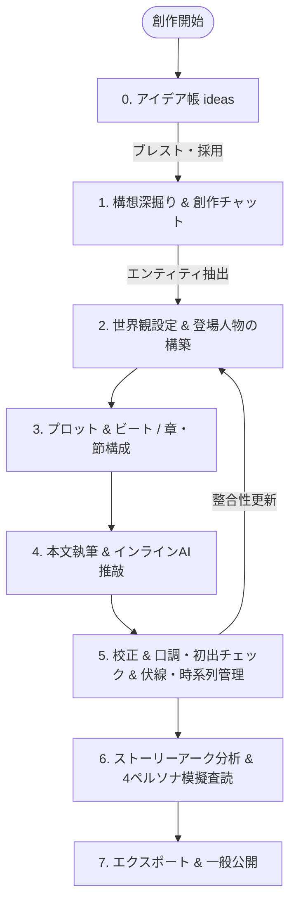
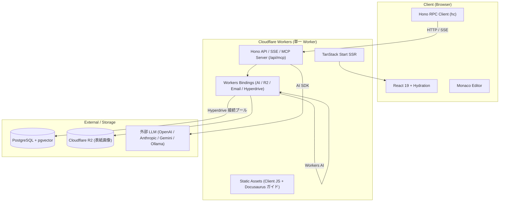

「AI に小説を書かせる」と聞くと、プロンプトを 1 本投げて出力させるイメージを持つかもしれません。しかし実際に長編や意図通りの物語を書かせようとすると、文章のリズム、キャラクターの一貫性、伏線の管理、前後の文脈など、**素朴なプロンプトだけでは破綻するポイント**が次々と現れます。

本記事では、プロット構想から設定管理、本文執筆、推敲、分析、一般公開までを一貫して支援する Web アプリケーション **「ノベクリ - Novel Creator」** の設計と実装を題材に、**「AI に目的の小説を書かせるために何が必要か」**、そしてそれを**Cloudflare Workers 単一配信構成でいかに低コストに運用しているか**を解説します。

---

# AIにそのまま小説を書かせるとどうなるのか

LLM に「こういう設定で、このシーンを書いて」とそのまま指示を出すと、短い掌編なら読める文章が出てきます。しかし、章や節（シーン）を重ねる物語では、主に次の 3 つの軸で破綻が起きます。

## 1. 文章・リズム・組版の崩れ

日本語の小説として読める品質を保つだけでも、LLM 特有の癖が障害になります。

- **あらすじの早足消化（Show, Don't Tell の欠如）**:
  節の概要を渡すと、情景・五感・会話の間・仕草を描かずに、出来事を箇条書きのように要約して数段落で終わらせてしまいます。
- **勝手な総括ナレーション**:
  節の終わりを「こうして二人の運命は大きく動き出すのだった」のような安易な教訓・解説で勝手に締めてしまいます。
- **小説作法・組版ルールの無視**:
  地の文の段落冒頭の全角字下げ、会話文（「」）末尾の句点省略、三点リーダー（`……`）やダッシュ（`――`）の 2 連使用、ルビ記法（`｜親文字《るび》`）などが安定しません。

## 2. 長編特有の文脈・整合性の破綻

章・節をまたいで執筆を進めると、物語構造レベルの破綻が顕著になります。

- **キャラブレ（口調・一人称の崩壊）**:
  登場人物が増えると、一人称や二人称、語尾、性格が他のキャラクターと混ざります。
- **初登場人物の前提化**:
  その節で初めて登場するキャラクターなのに、読者がすでに外見や関係性を知っている前提で名前だけ出して会話を始めてしまいます。
- **伏線のネタバレ・早期回収**:
  プロンプトの整合性を保つために「未回収の伏線設定（真相や秘密）」を渡すと、LLM が気を利かせてしまい、その場で登場人物に真相を看破させたり種明かしをしてしまいます。
- **次節の先取り**:
  物語のつながりを意識させようと次の節の予定を渡すと、今の節の最後で次の節の出来事まで書いてしまいます。
- **確定事実の矛盾と直前文の重複**:
  「誰が何を知っているか」「生死や所在」が前後で食い違ったり、前の節の末尾のセリフ・描写を次の節の冒頭でそのまま書き直してしまったりします。

## 3. コンテキスト肥大と検索漏れ

作品が大きくなるほど、人物・世界観・用語・過去本文のすべてをプロンプトに詰め込むことはできなくなります（コンテキスト長・コスト・ノイズの増大）。かといって単純なベクトル検索（RAG）だけに頼ると、「名前が直接登場しているのに意味的類似度が低くて設定が拾われない」といった固有名詞の取りこぼしが起きます。

---

# 目的の小説を書かせるために必要なこと

上記の破綻を防ぐため、ノベクリでは「プロンプトを工夫する」だけでなく、**創作データの構造化・コンテキスト制御・知識境界の明示・Human-in-the-loop** を組み合わせた設計を採っています。

## 1. 創作プロセスの段階的構造化

いきなり本文を書かせるのではなく、粒度を段階的に落とし込むワークフローを用意しています。

各節（シーン）には、**POV（視点人物）・場所・時系列・登場人物（キャスト）** のメタデータやビート（場面の予定）を紐付けられるようになっており、執筆時に AI が迷わない土台を作っています。

## 2. コンテキストエンジニアリング（ハイブリッド検索と予算管理）

本文生成時に渡す情報は、以下の 2 段構えで抽出・制御します。

- **ベクトル検索 × 名前一致の確定参照（メンション）**:
  `pgvector` によるセマンティック検索に加え、節の概要や直前本文に含まれる固有名詞（登場人物・設定・用語）を名前一致で確実に拾うハイブリッド方式を採っています。
- **優先度付きの文字数予算管理と可視化**:
  プロンプト全体の文字数上限（予算）を定め、優先度の高いブロックから順に詰め込み、溢れたブロックは明示的に落とします。さらに「実際にどの情報がプロンプトに入ったか・落ちたか」を UI のプレビューで確認できるようにしています。

## 3. 知識制限とガードレール（書いてはいけないことの明示）

AI に「何を書くか」だけでなく「**何をしてはいけないか（知識境界）**」を構造化して渡します。

- **確定事実（Story Facts）と直前ダイジェスト**:
  執筆済み本文から「誰が何を知ったか」「生死・所在・状態」を構造化抽出し、確定事項（Established Facts）として固定します。
- **未回収伏線と次節予定の分離**:
  未回収の伏線は「作者用の非公開情報（ネタバレ・早期回収禁止）」、次の節の概要は「先取り禁止の境界線」として明示的に分離して渡します。
- **過去本文の役割限定**:
  過去の本文抜粋は「設定・固有名詞・時系列の整合確認用」と明記し、文体の引きずりや表現の流用を禁止します。
- **執筆後の自動検証**:
  本文生成後も、初登場人物の描写抜けチェック、口調ブレチェック、設定変更の影響分析など、検証専用のプロンプトで事後チェックを行います。

## 4. 人間が主導権を握る協調ワークフロー

- **提案カード＋差分確認（Human-in-the-loop）**:
  創作チャットで新しい設定やプロット変更が固まっても、AI が勝手に DB を書き換えることはしません。承認カードを提案し、人間が差分（Diff）を確認してワンクリックで反映します。
- **一時指定と恒常ルールの分離**:
  作品全体の「文体ガイドライン」とは別に、リクエスト単位の「生成指定（長さ・温度・人称・時制）」をエフェメラルな指示ブロックとして分離し、設定汚染を防いでいます。
- **複数案の並列比較**:
  インライン推敲では最大 3 つのバリエーションを並列ストリーミング生成し、タブ切替や 2 カラム比較で人間が選んで反映できます。

---

# 実装内容

ここからは、ノベクリのコードベースにおける具体的なアーキテクチャと実装内容を紹介します。

## 1. Cloudflare Workers 単一配信によるインフラ集約とコスト削減

ノベクリは、AI 機能やベクトル検索を備えながらも、**個人〜スモールチームで無理なく運用できるインフラコスト**を重視し、Cloudflare Workers を中心とした単一配信アーキテクチャを採用しています。

### コスト削減に効いている設計ポイント

1. **1 つの Worker にフルスタックを集約（固定費ゼロ構成）**:
   フロントエンド（TanStack Start / React 19 SSR）、静的アセット（Docusaurus でビルドしたユーザーガイド `/guide/` を含む）、Hono API サーバー、さらに外部連携用の MCP サーバー（`POST /api/mcp`）までを **単一の Cloudflare Worker** で一括配信しています。フロント用・API 用・MCP 用に別々のサーバーやコンテナを常時稼働させる必要がなく、アイドル時の固定費が発生しません。
2. **Cloudflare ネイティブバインディングによる外部 SaaS 課金の削減**:
   - **Cloudflare Workers AI**: バインディング経由で LLM（例: `@cf/google/gemma-4-26b-a4b-it`）や Embedding（例: `@cf/baai/bge-m3`）をシステム既定として利用でき、低単価で動作します（ユーザー自身の API キーを使う BYOK との併用も可能）。
   - **Cloudflare R2**: 表紙画像アセットの保存に利用し、エグレス（転送料金）をゼロに抑えています。
   - **Cloudflare Hyperdrive**: 外部 PostgreSQL（`pgvector` 拡張付き）への接続プーリングとキャッシュをエッジ側で担い、サーバーレス環境特有のコネクション枯渇や DB 負荷を抑えています。
   - **Cloudflare Email Service (`send_email` バインディング)**: アカウント削除の再認証コード送信などに外部メール配信 SaaS を追加契約せず、Worker ネイティブで完結させています（ローカル開発時は送信をスキップするフォールバックを用意）。
3. **Workers の起動・バンドル制約を意識した最適化**:
   - `apps/app/src/server.ts` ではサーバー本体（`./server/app.js` 配下の大量のモジュールや AI SDK）を動的 `import()` で遅延読み込みし、開発時・コールドスタート時の評価コストを抑えています。
   - `check:client-server-boundary` やビルド分析（`vite build --mode analyze`）により、サーバー専用モジュール（`pg` や LLM SDK 等）がクライアントバンドルへ混入しないよう継続的に監視しています。

## 2. End-to-End 型安全通信とリアルタイムストリーミング

- **Hono RPC (`hc<ApiType>`)**:
  サーバー側の Hono ルーター型 `ApiType` をクライアントが直接インポートし、OpenAPI 等のコード生成なしでリクエスト／レスポンスの型安全と補完を実現しています。
- **本文生成の SSE ストリーミング**:
  Hono の `streamSSE` と Vercel AI SDK の `streamText` を組み合わせ、生成チャンクをブラウザの `ReadableStreamDefaultReader` で受け取って Monaco Editor に逐次描画しています。
- **チャット用 UI Message Stream**:
  AI SDK の Data Stream Protocol（`toUIMessageStream` / `createUIMessageStreamResponse`）を採用し、テキスト応答だけでなく「どのツールをどんな引数で実行しているか」をリアルタイムに UI（`ToolActivity`）へ表示しています。

## 3. 本文生成プロンプトの組立エンジンと予算管理

本文生成の中核は、純粋関数 `assembleContentPrompt`（`apps/app/src/server/llm/prompts/contentGeneration/assemble.ts`）と、コンテキスト収集を行う `section-prompt.ts` です。

この関数は、**実際の本文生成処理と「プロンプトプレビュー機能」の両方から共通で呼び出される**ため、「プレビューで確認した内容と実際に AI に送られる内容がズレる」ことがありません。

組立時には以下のような **17 種類のブロック** を統合し、全体の文字数予算（`applyTotalBudget`）に収まるよう調整します。

| ブロックID | ソース種別 | 役割 |
| :--- | :--- | :--- |
| `scene` / `beat` / `sceneCast` | `scene` / `static` | 章・節情報、ビート予定、POV・場所・時系列・キャスト |
| `directives` | `static` | 今回の生成指定（長さ・温度・人称・時制） |
| `styleGuide` | `static` | 作品全体の文体ガイドライン |
| `previousContent` | `scene` | 直前の節の末尾本文（最大 4,000 文字） |
| `digests` / `storyFacts` | `digest` / `static` | 直前セクションのダイジェストと確定した事実 |
| `unintroduced` | `scene` | この節で初登場となる未紹介の登場人物リスト |
| `voiceProfiles` | `static` | 登場人物の一人称・二人称・口調プロファイル |
| `mentions` | `mention` | 名前一致で確実に拾った人物・設定・用語 |
| `characters` / `settings` / `glossary` / `contents` | `vector` | `pgvector` でセマンティック検索した関連情報 |
| `foreshadowing` | `vector` | 未回収の伏線情報（ネタバレ・早期回収禁止枠） |
| `nextSection` | `scene` | 次の節の予定（先取り禁止枠） |
| `materials` | `static` | 紐付けられた参考資料 |

クライアント側のプロンプトプレビュー（`SectionPromptPreview`）では、各ブロックのソース（`vector` / `mention` / `digest` / `scene` / `static`）や文字数、そして予算超過で除外された理由（`dropReason: "budget" | "empty"`）まで確認できます。

## 4. RAG × 状態抽出 × 事後チェックの整合性パイプライン

執筆前後の整合性を保つため、生成以外の周辺パイプラインも充実させています。

- **ハイブリッド検索 (`searchContextWithMentions`)**:
  エンティティ更新時に `upsertEntityEmbedding` で `pgvector` へ自動登録し、執筆時にはベクトル検索と名前一致メンションを組み合わせて取得します。埋め込みモデルの変更時に全作品を再インデックスする `POST /api/vector/reindex` も備えています。
- **本文からの確定事実抽出 (`extractStoryFacts.md`)**:
  執筆された本文を解析し、`subjectType`（人物・設定・関係・ルール・時間）と `predicate`（`knows` / `alive` / `location` / `status` / `rule`）、`polarity`（肯定/否定）の形式でストーリー状態を自動抽出します。
- **初登場人物の説明抜け検証 (`introductionCheck.md`)**:
  未紹介の登場人物が初めて本文に現れた箇所に、外見・人物像の自然な描写（1〜2 文）が含まれているかを検証し、漏れていれば引用箇所と追記案を提示します。
- **多角的な分析・推敲機能**:
  - **口調チェッカー**: 登録された人物プロファイルと本文セリフを照合し、キャラ崩壊を検出
  - **影響範囲シミュレーター**: 設定変更時に影響を受けるプロット・章節・年表・伏線を予測
  - **ストーリーアーク分析**: 全章節の緊張感（Tension: 0〜100）と感情価（Valence: -100〜+100）を SVG グラフで可視化
  - **4 ペルソナ模擬査読**: 商業編集者・一般読者・設定考察派・辛口文芸評論家の 4 視点で講評

## 5. Agentic チャット・エディタ体験・MCP サーバー連携

- **Agentic ツール実行システム（22 種のツール）**:
  創作相談チャットでは、AI SDK の Tool Calling を用いて **読み取り専用ツール 10 種**（小説情報、人物、設定、プロット、節本文のページング取得、資料、伏線、年表、構想、ベクトル検索）と、**設定提案ツール 12 種**（人物・設定・伏線・年表・プロットの追加/更新/削除/一括登録）を提供しています。提案結果はチャット最下部の提案カードに表示され、**Monaco DiffEditor** で全文の差分を確認してから反映できます。
- **執筆エディタ体験**:
  Monaco Editor ベースの執筆画面に加え、選択範囲に対して標準アクションやユーザー定義のカスタムプロンプトを実行し、最大 3 案を並列ストリーミング生成・比較できるインライン AI 推敲を備えています。CSS `writing-mode: vertical-rl` によるルビ・傍点対応の縦書き文庫本プレビューも搭載しています。
- **MCP サーバー標準搭載 (`POST /api/mcp`)**:
  Streamable HTTP トランスポートによる MCP（Model Context Protocol）サーバーを同一 Worker 内に内蔵しており、Claude Code などの外部 AI エージェントから小説・章・節・人物・設定・伏線・年表・アイデア帳を直接操作できます。認証は Web 発行の API キー（`mcp_`）または OAuth 2.1（PKCE・動的クライアント登録対応）による小説単位スコープのアクセストークン（`mcpo_`）を採用しています。

---

# まとめ

AI に狙い通りの小説を書かせるために必要なのは、モデルの賢さに丸投げすることではなく、以下の 3 点をシステムとして支えることでした。

1. **文体・作法・知識境界のガードレール**: 読点や語尾の癖を抑え、未回収伏線のネタバレや次節の先取りを構造的に防ぐこと
2. **コンテキストエンジニアリング**: ベクトル検索と名前一致メンションを組み合わせ、予算内で過不足なく情報を届け、結果を可視化すること
3. **持続可能性のあるインフラ設計**: Cloudflare Workers の単一配信とネイティブサービス（Workers AI / R2 / Hyperdrive / Email Service）を活用し、多機能な創作環境を低コストで維持すること

LLM の表現力とソフトウェアエンジニアリングによる構造制御を組み合わせることで、AI は単なる「文章生成器」から、長編創作に寄り添う実用的なパートナーへと近づきます。

https://novel-creator.croud.jp/
