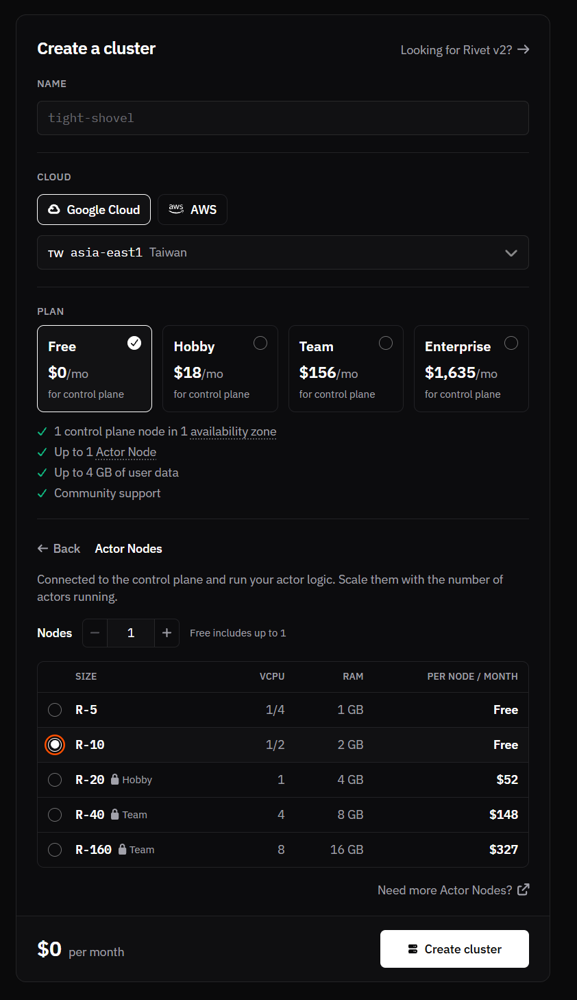

# はじめに

Deno Deploy のサービス終了のアナウンスを受け、エッジやサーバーレス環境で動かしていた WebAssembly（WASM）ツール（画像最適化や動的 OGP 生成など）の移行先を探していました。選定条件としては、低コストかつ商用利用が可能で、メモリ制限が厳しくないことです。安価な選択肢としては Cloudflare Workers が筆頭に挙がりますが、メモリ上限が 128MB に制限されているため、画像処理やフォントレンダリングを伴う用途にはやや厳しい面があります。

そこで有力な候補として見つけたのが Rivet です。無料プランでありながら 2GB のメモリを利用できます。本記事では、Rivet の特徴や無料枠の実際の仕様をはじめ、WASM（`wasm-html-to-image`）を用いた画像最適化と動的 OGP 生成（Hono JSX + Mermaid + 縦書き対応）を Rivet アクターとして実装・デプロイした知見をまとめます。

---

# Rivet とは

[Rivet](https://rivet.dev/)（RivetKit）は、ステートフルなアクターモデル（Actor Model）を TypeScript / Web 標準スタックで構築できるプラットフォームです。

従来の一般的なサーバーレス（AWS Lambda や Cloudflare Workers）と比べると、次のような強みがあります。

1. アクターごとに独立した組み込み SQLite（Durable State）
   - アクターごとに専用の SQLite データベースが自動プロビジョニングされます。
   - 外部の KV や Redis、データベースを個別に契約しなくても、プロセスローカルな超低レイテンシでキャッシュや状態管理が行えます。
2. Dockerfile ベースの柔軟なコンテナ実行
   - 制限の多いエッジランタイム（V8 isolate のみ）とは異なり、コンテナベースで動作するため、Node.js のネイティブモジュールや WebAssembly（WASM）バイナリが制約なく動作します。
3. HTTP ゲートウェイと型安全な RPC
   - 通常の Web リクエストを受ける低レベル HTTP ハンドラ（`onRequest`）と、クライアント SDK から直接型安全に呼び出せる RPC メソッド（`actions`）の両方を 1 つのアクターで定義できます。
4. 自動スリープ & 即時復帰
   - リクエストがないときはメモリを解放して自動的にスリープし、リクエストが届くとミリ秒単位で即座に復帰します。

---

# Rivet の無料枠とリソース仕様

Rivet Cloud（Free プラン）の仕様を API や実機メトリクスから調査したところ、一般的なサーバーレスとは異なる特徴的な枠設計になっていました。

### 1. 「CPU 時間の合算上限」ではなく「ノード上限型」
一般的な FaaS（月あたり 100,000 秒まで等の CPU 時間クォータ制）とは異なり、Rivet の無料プランは「1 ノード（最大 0.5 vCPU / 2GB RAM）が常時割り当て可能」という仕様になっています。

| 項目 | 設定値 / 仕様 | 備考 |
| :--- | :--- | :--- |
| **課金フラグ (`runners.billed`)** | `false` | 無料枠内で動作（自動的な課金なし） |
| **最大ノード数 (`max_nodes`)** | 1 台 | 常時割り当て可能 |
| **選択可能マシンタイプ** | `R-5` (`e2-micro`: 0.25 vCPU / 1 GB RAM)<br>`R-10` (`e2-small`: 0.5 vCPU / 2 GB RAM) | Free プランでも最大スペックの `R-10` を選択可能 |
| **ストレージ** | 4 GB | |
| **転送量 (Egress)** | 100 GB / 月 | |

### 2. CPU を使い続けた場合の挙動
Free プランで割り当てられる `e2-small`（0.5 vCPU）は GCP の共有コアインスタンスです。
- CPU 時間による従量課金が勝手に発生することはありません。
- ただし、常時 100% の負荷をかけ続けると、クラウド基盤側で CPU スロットリング（一時的な速度制限）が発生します。
- 画像変換や OGP 生成のように「アクセスが来た瞬間にサッと処理し、終わったらアイドル/スリープする」用途であれば、リソース使用率は数%台で非常に快適に推移します。

### 3. プロジェクト作成時の設定

基本的には無料枠で十分動作するため Free プランを選択します。リージョンは日本から最も地理的に近い asia-east1（台湾）を選ぶのがおすすめです。
また、Actor Nodes の設定で `R-10` を選択すると、無料枠の範囲内のままスペックを 0.5 vCPU / 2GB RAM に引き上げられます。



---

# 実際に作ったもの

今回は以下の 2 つのサービスを Rivet アクターとして実装しました。

1. `rivet-image-optimization`: URL 指定された画像を取得し、WASM で AVIF / WebP / JPEG にリサイズ・軽量化して SQLite に永続キャッシュするアクター。
2. `rivet-ogp`: Hono JSX で 1200×630 のリッチなカードを構築し、UnoCSS / Tailwind の動的 CSS 生成、Mermaid ダイアグラム描画、CSS 縦書きバッジを組み合わせて WASM で PNG レンダリングする OGP 生成アクター。

ちなみに画像変換の実験では、6500*6500の画像出力に成功しました。4K画像レベルなら余裕です。

---

# 実装コードの解説

## 1. アクター定義と SQLite キャッシュ

RivetKit では `actor` 関数の中で `db` オプションを指定するだけで、マイグレーション付きの SQLite が利用できます。

```tsx:src/index.tsx
import { actor, setup } from "rivetkit";
import { db } from "rivetkit/db";
import { render } from "wasm-html-to-image";
import { createCSS } from "wasm-html-to-image/tailwind";

export const IMAGE_CACHE_SCHEMA = `
  CREATE TABLE IF NOT EXISTS image_cache (
    key TEXT PRIMARY KEY,
    content_type TEXT NOT NULL,
    data BLOB NOT NULL,
    created_at INTEGER NOT NULL
  );
  CREATE INDEX IF NOT EXISTS idx_image_cache_created_at ON image_cache(created_at);
`;

export const ogpGenerator = actor({
  // アクター専用の SQLite データベース
  db: db({
    onMigrate: async (database) => {
      await database.execute(IMAGE_CACHE_SCHEMA);
    },
  }),

  // 生の HTTP リクエストを受け取るハンドラ
  onRequest: handleOgpRequest,

  // クライアントから呼べる型安全な RPC アクション
  actions: {
    async generate(c, params: OgpOptions) {
      return generateOgpImage(c.db, params);
    },
  },
});

export const registry = setup({
  use: {
    ogpGenerator,
  },
});

// Rivet Cloud ランナー環境で自動起動
if (process.env.RIVET_ENDPOINT || process.env.RIVET_RUNNER) {
  registry.start();
}
```

## 2. キャッシュ判定と WASM レンダリング

リクエストが来たら、まず SQLite の `image_cache` を検索します。ヒットすればそのままバイナリを返し、ヘッダーに `X-Cache: HIT` を付与します。キャッシュがない場合のみ、HTML を構築して WASM エンジンでレンダリングします。

```tsx:src/index.tsx
export async function generateOgpImage(
  database: CacheDatabase,
  options: OgpOptions,
): Promise<OgpResult> {
  const cacheKey = buildCacheKey(options);

  // 1. SQLite キャッシュをチェック
  const rows = await database.execute<CacheRow>(
    "SELECT content_type, data FROM image_cache WHERE key = ?",
    cacheKey,
  );
  if (rows[0]) {
    return {
      contentType: rows[0].content_type,
      data: new Uint8Array(rows[0].data),
      cached: true,
    };
  }

  // 2. Hono JSX による HTML 構築と UnoCSS のオンデマンド CSS 生成
  const html = renderOgpTemplate(options);
  const css = await createCSS(html);

  // 3. wasm-html-to-image による PNG レンダリング（Headless Chrome 不要）
  const rendered = await render({
    value: html,
    css,
    width: 1200,
    height: 630,
    format: "png",
  });

  const responseData =
    typeof rendered.data === "string"
      ? new TextEncoder().encode(rendered.data)
      : new Uint8Array(rendered.data);

  // 4. SQLite にキャッシュを保存
  await database.execute(
    "INSERT OR REPLACE INTO image_cache (key, content_type, data, created_at) VALUES (?, ?, ?, ?)",
    cacheKey,
    "image/png",
    responseData,
    Date.now(),
  );

  return {
    contentType: "image/png",
    data: responseData,
    cached: false,
  };
}
```

## 3. Hono JSX によるリッチな OGP テンプレート

Headless Chrome を起動せず、WASM のみで高品位な OGP 画像を描画します。Mermaid ダイアグラムの埋め込みや CSS 縦書き（`writing-mode: vertical-rl`）もそのまま記述できます。

```tsx:src/index.tsx
export function renderOgpTemplate(options: OgpOptions): string {
  const { title = "Title", subtitle = "subtitle", vertical = "縦書き対応" } = options;

  return (
    <html className="m-0 p-0">
      <head>
        <link
          href="https://fonts.googleapis.com/css2?family=Noto+Sans+JP:wght@100..900&display=swap"
          rel="stylesheet"
        />
        <style>{`
          .vertical-pill {
            writing-mode: vertical-rl;
            text-orientation: upright;
            letter-spacing: 0.35em;
            font-family: 'Noto Sans JP', sans-serif;
          }
          .mermaid {
            --mermaid-theme: dark;
            color: #cdd6f4;
          }
        `}</style>
      </head>
      <body className="m-0 p-0">
        <div className="w-[1200px] h-[630px] flex relative bg-[#0a0a0c] overflow-hidden">
          {/* 左カラム: タイトルとサブタイトル */}
          <div className="flex flex-col w-[530px] h-full p-[60px] justify-between z-10">
            <div>
              <div className="text-[68px] font-black text-white leading-[1.1] mb-[24px]">
                {title}
              </div>
              <div className="text-[28px] text-[#94a3b8]">{subtitle}</div>
            </div>
            <div className="text-sm text-slate-400">Powered by Rivet</div>
          </div>

          {/* 中央: 縦書きアクセントピル */}
          <div className="absolute top-[60px] left-[570px] z-20">
            <div className="vertical-pill text-[13px] font-bold text-[#c7d2fe] border border-indigo-400/40 p-4 rounded-3xl backdrop-blur-md">
              {vertical}
            </div>
          </div>

          {/* 右カラム: Mermaid ダイアグラムウィンドウ */}
          <div className="relative flex-1 h-full z-10 p-10 flex items-center justify-center">
            <div className="w-[500px] h-[260px] rounded-2xl border border-white/20 p-4 bg-white/5 backdrop-blur-md">
              <div className="mermaid">
                {options.mermaid ?? "flowchart LR\nClient --> Rivet[Rivet Actor] --> Image"}
              </div>
            </div>
          </div>
        </div>
      </body>
    </html>
  ).toString();
}
```

---

# デプロイと運用のポイント・注意点

実際にデプロイするにあたって、いくつか重要な注意点やハマりどころがありました。

### 1. 公式 CLI のパッケージ名は `rivet` ではなく `@rivetkit/cli`
ドキュメントでは `rivet deploy` のように `rivet` コマンドで説明されていることが多いですが、npm でそのまま `npm install -g rivet` や `npx rivet` を実行すると、同名で登録されている別物の古いパッケージ（v1.0.7）がインストールされてしまいます。当然 `deploy` コマンドなどは存在せずエラーになります。

公式の Rivet CLI の正しいパッケージ名は `@rivetkit/cli` です。

```bash
# 誤り: 別の古いパッケージが入る
npm install -g rivet

# 正しい: 公式の Rivet CLI
npm install -g @rivetkit/cli
# または
npx @rivetkit/cli deploy
```

### 2. Windows ネイティブ環境には未対応（WSL / Linux が必須）
現在、Rivet CLI（`@rivetkit/cli`）のバイナリパッケージは Linux（x64 / arm64）および macOS（x64 / arm64）のみ提供されています。

Windows の PowerShell やコマンドプロンプトでそのまま実行しようとすると、以下のようなエラーが発生します。

```text
Error: Windows x64 is not yet supported via npm platform packages
```

そのため、Windows 環境で開発・デプロイを行う場合は、WSL（Windows Subsystem for Linux）上の Node.js 環境から CLI を実行する必要があります。

```bash
# WSL 側で CLI を実行
wsl bash -ic "npx @rivetkit/cli deploy"
```

### 3. マルチステージビルドによるイメージ削減
Rivet へのデプロイは Dockerfile を使って行われます。開発依存パッケージを含めたまま素直にビルドするとイメージサイズが 1GB を超えてしまい、デプロイや起動に時間がかかってしまいます。
以下のようにマルチステージビルドを組むことで、イメージサイズを約 500MB 程度まで軽量化できます。

```dockerfile:Dockerfile
# --- 1. ビルドステージ ---
FROM node:22-bookworm-slim AS builder
WORKDIR /app
COPY package.json tsconfig.json ./
RUN npm install
COPY src ./src
RUN npm run build

# --- 2. 実行ステージ（スリム化） ---
FROM node:22-bookworm-slim AS runner
WORKDIR /app
ENV NODE_ENV=production

COPY package.json ./
RUN npm install --omit=dev && npm cache clean --force

COPY assets ./assets
COPY --from=builder /app/dist ./dist

ENV PORT=3000
EXPOSE 3000

CMD ["node", "dist/server.js"]
```

### 4. デプロイ時のクラスタ上書きに注意
Rivet では、`rivet deploy` はクラスタ単位で反映されます。
複数のサービスを運用したい場合、同一のクラスタ（例: `"cluster": "cloud"`）に対して別プロジェクトからデプロイを実行すると、既存のビルドが新しいプロジェクトのイメージで上書きされてしまいます。

複数の機能を共存させたい場合は、以下のいずれかのアプローチを取るのがおすすめです。

1. マルチアクター構成（推奨）:
   1 つのコンテナ内に両方のアクターを含め、`setup({ use: { imageOptimizer, ogpGenerator } })` としてまとめてデプロイします。Free プランの 1 ノードを効率的に共用できます。
2. プロジェクト / クラスタを分離する:
   ダッシュボードからプロジェクトごとに新しいクラスタを作成し、別々のエンドポイントとしてデプロイします。

---

# まとめ

Deno Deploy の移行先を探す中で見つけた Rivet ですが、実際に動かしてみて特に次のように感じました。

- 組み込み SQLite がアクターと一体化しており、キャッシュや永続化の設計が非常にシンプル
- Dockerfile によるコンテナの自由度を持ちながら、サーバーレスのように自動スリープ・即時復帰が可能
- 無料プランでも 0.5 vCPU / 2GB RAM の実用的なスペックが確保されており、WASM などのメモリを消費する処理も快適に動作する

ステートフルなバックエンドや、WASM・ネイティブバイナリを伴うサーバーレス構成を検討している方は、ぜひ一度 Rivet を試してみてはいかがでしょうか。
