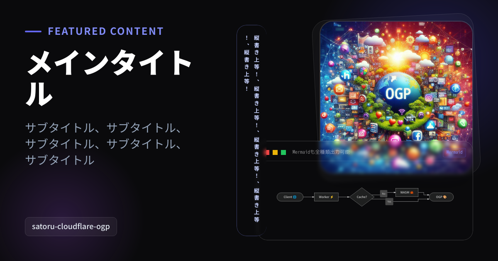

# はじめに

Cloudflare Workers 上で OGP 画像（1200×630 PNG）を動的生成する場合、Satori を使う構成がよく知られています。ただ、Satori は Yoga エンジン（Flexbox）ベースのため扱える CSS プロパティに制限があり、凝ったレイアウトを組む際に工夫が必要になることがあります。

今回はこの構成を Hono JSX に移行し、あわせて Mermaid の描画や CSS による縦書き表示を組み込んだ OGP 生成の実装例を紹介します。

---

# 生成される OGP 画像

Cloudflare Workers 上で生成した OGP 画像がこちらです。



### 含まれている要素
- Google Fonts（Noto Sans JP）のフォント適用
- HTML 内の `<div class="mermaid">` を使ったダイアグラム描画
- アスペクト比 1:1 の画像配置
- `writing-mode: vertical-rl` による縦書きバッジ
- 画像と Mermaid ウィンドウの重ね合わせレイアウト

Headless Chrome や Puppeteer などを動かすことなく、Workers 単体でレンダリングしています。

---

# 1. Hono JSX の利用

### Hono JSX を採用した理由

`wasm-html-to-image` は HTML 文字列を受け取って画像を生成するため、仮想 DOM を一度 HTML にシリアライズする必要があります。Hono JSX を使うとこの処理をシンプルに記述できます。

- `.toString()` で変換可能: JSX 要素に対してそのまま `.toString()` を呼ぶだけで HTML 文字列が得られます。別途レンダラーを用意する必要がありません。
- JSX プラグマが不要: TypeScript の `react-jsx` 変換に対応しているため、ファイル先頭に `/** @jsx h */` を書いたり `h` をインポートしたりする必要がありません。

### `tsconfig.json` の設定
`jsxImportSource` に `hono/jsx` を指定します。

```json:tsconfig.json
{
  "compilerOptions": {
    "target": "ESNext",
    "module": "ESNext",
    "moduleResolution": "bundler",
    "strict": true,
    "skipLibCheck": true,
    "lib": ["ESNext", "WebWorker"],
    "types": ["@cloudflare/workers-types"],
    "isolatedModules": true,
    "esModuleInterop": true,
    "jsx": "react-jsx",
    "jsxImportSource": "hono/jsx",
    "noEmit": true
  },
  "include": ["src"]
}
```

これで、JSX を記述して `.toString()` した結果をそのまま `wasm-html-to-image` の `render()` に渡せます。

---

# 2. ローカルアセット（画像）のバンドル読み込み

OGP 生成のたびに外部から画像を `fetch` すると、レイテンシの増加や外部障害の影響を受けやすくなります。

Cloudflare Workers (Wrangler) では、`rules` に Data モジュールルールを設定することで、プロジェクト内の静的アセットを `ArrayBuffer` として直接インポートできます。

ネットワーク上の画像は、アドレスを指定すればそのまま描画されます。

### `wrangler.jsonc` の設定

WebP や AVIF も扱えるため、必要に応じて glob を調整してください。

```jsonc:wrangler.jsonc
{
  "$schema": "node_modules/wrangler/config-schema.json",
  "name": "cloudflare-ogp",
  "main": "src/index.tsx",
  "compatibility_date": "2026-10-30",
  "rules": [
    { "type": "Data", "globs": ["**/*.jpg", "**/*.png"], "fallthrough": false },
  ],
  "observability": {
    "enabled": true,
  },
}
```

### TypeScript 型定義の追加

インポート時の型エラーを防ぐため、アンビエント宣言を追加します。

```ts:src/types.d.ts
declare module "*.jpg" {
  const content: ArrayBuffer;
  export default content;
}

declare module "*.png" {
  const content: ArrayBuffer;
  export default content;
}
```

### コード内での Base64 Data URL 化

インポートしたバッファを Base64 文字列（Data URL）へ変換し、モジュールトップレベルで一度だけ保持しておきます。

```tsx:src/index.tsx
import defaultImageBuffer from "../assets/image.jpg";

function toBase64(buffer: ArrayBuffer): string {
  const bytes = new Uint8Array(buffer);
  let binary = "";
  for (let i = 0; i < bytes.byteLength; i += 8192) {
    binary += String.fromCharCode(...bytes.subarray(i, i + 8192));
  }
  return btoa(binary);
}

const DEFAULT_IMAGE = `data:image/jpeg;base64,${toBase64(defaultImageBuffer)}`;
```

これにより、リクエストごとの fetch やエンコード処理を行わずに画像を埋め込めます。

---

# 3. `<div class="mermaid">` による描画

Mermaid.js はブラウザ DOM（D3.js や SVG DOM API）に依存しているため、サーバーサイドやエッジ環境で動かすには Headless Chrome 等を用意するのが一般的でした。

`wasm-html-to-image` の WASM エンジンには C++ で実装された Mermaid パーサーとレイアウトエンジンが組み込まれており、HTML 内に `<div class="mermaid">` を配置するだけでダイアグラムがベクター描画されます。

対応している図の種類についてはドキュメントを参照してください。

https://sorakumo001.github.io/wasm-html-to-image/master/docs/docs/api-reference/mermaid#6-%E5%AF%BE%E5%BF%9C%E3%81%97%E3%81%A6%E3%81%84%E3%82%8B%E5%9B%B3

```tsx
const mermaidSource = `graph LR
  Client[Client 🌐] --> Worker[Worker ⚡]
  Worker --> WASM[WASM 🦀]
  WASM --> Image[OGP 🎨]
  classDef default fill:#1e1e2e,stroke:#818cf8,stroke-width:1.5px,color:#cdd6f4`;
```

```tsx
<div className="mermaid">
  {mermaidSource}
</div>
```

### 見切れ防止のスタイル指定
Mermaid のダイアグラムは、ノード数やレイアウト方向によってサイズが大きくなることがあります（例えば `graph LR` では横長になりやすいです）。

固定サイズの枠内に収めるため、CSS で以下のようにスタイルを指定します。

```css
.mermaid {
  --mermaid-theme: dark;
  color: #cdd6f4;
  display: flex;
  align-items: center;
  justify-content: center;
  width: 100%;
  height: 100%;
}
.mermaid svg {
  width: 100% !important;
  max-width: 100% !important;
  height: auto !important;
  max-height: 100% !important;
}
```

レンダラーが `<div class="mermaid">` を展開して `<svg>` を生成した際、`max-width: 100%` と `height: auto` により、枠からはみ出さず縦横比を保ったまま収まります。

---

# 4. 縦書きの描画

`wasm-html-to-image` は HarfBuzz と Skia を統合しているため、縦書きのテキスト配置や約物の回転にも対応しています。

### 縦書きスタイルの指定

```css
.vertical-pill {
  writing-mode: vertical-rl;
  text-orientation: upright;
  white-space: nowrap;
  letter-spacing: 0.35em;
  font-family: 'Noto Sans JP', sans-serif;
}
```

### パディング調整
縦書き（`writing-mode: vertical-rl`）ではインライン方向が上から下（縦方向）になります。

上下の端に余白を確保してカプセル形状に収める場合、インライン方向のパディングを意識して指定します。

```tsx
<div
  className="vertical-pill text-[13px] font-bold text-[#c7d2fe] bg-[#141424]/90 border border-[#818cf8]/40 shadow-[0_10px_25px_rgba(0,0,0,0.6)] backdrop-blur-md"
  style={{ padding: "28px 10px", borderRadius: "24px" }}
>
  {verticalText}
</div>
```

`padding: 28px 10px` と `borderRadius: 24px` を指定することで、先頭や末尾の文字が境界線に詰まらず、自然な余白のカプセル型バッジになります。

---

# 5. 重ね合わせによるレイアウト設計

1200×630 の枠内にタイトル、画像、Mermaid ダイアグラム、縦書きバッジを並べる際、単純に左右や上下で等分すると画像が横長にトリミングされたり、Mermaid の領域が狭くなったりします。

ここでは要素を重ね合わせて配置しています。

```
+---------------------------------------------------------------+
|  -- FEATURED CONTENT               +-----------------------+  |
|                         [超]       |                       |  |
|  Title                  [高]       |      Cover Photo      |  |
|                         [速]       |   (1:1 Square Image)  |  |
|  subtitle               [エ]       +------------+----------+  |
|                         [ッ]       | ● ● ● mmd  | Mermaid  |  |
|                         [ジ]       |-----------------------|  |
|  [satoru-cloudflare-ogp][生]       | Client -> Worker->... |  |
|                         [成]       +-----------------------+  |
+---------------------------------------------------------------+
```

1. 左側: タイトル・サブタイトル・タグのテキスト領域（幅 530px）
2. 中央: 縦書きピルバッジを配置
3. 右側（背面）: 1:1（370×370）の正方形画像カード
4. 右側（前面）: Mermaid ウィンドウ（520×240）を重ねて配置

前面のウィンドウに半透明背景（`bg-[#0f1017]/95`）とシャドウを適用し、背面の画像と重なっても文字が読み取れるようにしています。

---

# 全体実装コード

すべての要素を統合した `src/index.tsx` の全コードです。

```tsx:src/index.tsx
import { Hono } from "hono";
import { render } from "wasm-html-to-image/workerd";
import { createCSS } from "wasm-html-to-image/tailwind";
import defaultImageBuffer from "../assets/image.jpg";

function toBase64(buffer: ArrayBuffer): string {
  const bytes = new Uint8Array(buffer);
  let binary = "";
  for (let i = 0; i < bytes.byteLength; i += 8192) {
    binary += String.fromCharCode(...bytes.subarray(i, i + 8192));
  }
  return btoa(binary);
}

const DEFAULT_IMAGE = `data:image/jpeg;base64,${toBase64(defaultImageBuffer)}`;

const DEFAULT_MERMAID = `flowchart LR
  Client([Client 🌐]) --> Worker[Worker ⚡]
  Worker --> Cache{Cache?}
  Cache -- Yes --> Image([OGP 🎨])
  Cache -- No --> WASM[WASM 🦀] --> Image
  classDef default fill:#1e1e2e,stroke:#818cf8,stroke-width:1.5px,color:#cdd6f4`;

const DEFAULT_VERTICAL =
  "縦書き上等！、縦書き上等！、縦書き上等！、縦書き上等！、縦書き上等！";

const app = new Hono();

app.get("/", async (c) => {
  const subtitle = c.req.query("subtitle") ?? "subtitle";
  const title = c.req.query("title") ?? "Title";
  const image = c.req.query("image") ?? DEFAULT_IMAGE;
  const mermaidSource = c.req.query("mermaid") ?? DEFAULT_MERMAID;
  const verticalText = c.req.query("vertical") ?? DEFAULT_VERTICAL;

  const cache = await caches.open("satoru-cloudflare-ogp");
  const cacheKey = new Request(c.req.url);

  // Define OGP layout using JSX
  const html = (
    <html className="m-0 p-0">
      <head>
        <link
          href="https://fonts.googleapis.com/css2?family=Noto+Sans+JP:wght@100..900&display=swap"
          rel="stylesheet"
        />
        <style>{`
          .mermaid {
            --mermaid-theme: dark;
            color: #cdd6f4;
            display: flex;
            align-items: center;
            justify-content: center;
            width: 100%;
            height: 100%;
          }
          .mermaid svg {
            width: 100% !important;
            max-width: 100% !important;
            height: auto !important;
            max-height: 100% !important;
          }
          .vertical-pill {
            writing-mode: vertical-rl;
            text-orientation: upright;
            letter-spacing: 0.35em;
            line-height: 1.8;
            word-break: break-all;
            font-family: 'Noto Sans JP', sans-serif;
          }
        `}</style>
      </head>
      <body className="m-0 p-0">
        <div className="w-[1200px] h-[630px] flex relative bg-[#0a0a0c] overflow-hidden">
          {/* Background decorative gradients */}
          <div className="absolute top-[-150px] right-[-150px] w-[600px] h-[600px] rounded-[300px] bg-[radial-gradient(circle,_rgba(79,70,229,0.3)_0%,_rgba(79,70,229,0)_70%)] flex" />
          <div className="absolute bottom-[-100px] left-[-50px] w-[400px] h-[400px] rounded-[200px] bg-[radial-gradient(circle,_rgba(168,85,247,0.2)_0%,_rgba(168,85,247,0)_70%)] flex" />

          {/* Left Column: Typography & Info */}
          <div className="flex flex-col w-[530px] h-full p-[60px] justify-between z-10">
            <div className="flex flex-col">
              <div className="flex items-center mb-6">
                <div className="w-10 h-1 bg-[#6366f1] mr-[15px] rounded-sm" />
                <div className="text-2xl font-bold color-[#818cf8] tracking-widest uppercase flex">
                  Featured Content
                </div>
              </div>

              <div className="text-[68px] font-black text-white leading-[1.1] mb-[24px] break-words flex">
                {title}
              </div>

              <div className="text-[28px] font-normal text-[#94a3b8] leading-[1.4] flex">
                {subtitle}
              </div>
            </div>

            {/* Bottom Tag */}
            <div className="flex items-center">
              <div className="px-4 py-2 bg-white/5 border border-white/10 rounded-[10px] text-lg text-[#e2e8f0] font-medium flex">
                satoru-cloudflare-ogp
              </div>
            </div>
          </div>

          {/* Vertical Text Accent Pill (Floating between columns) */}
          {verticalText && verticalText !== "none" ? (
            <div className="absolute top-[60px] left-[570px] z-20">
              <div
                className="vertical-pill text-[13px] font-bold text-[#c7d2fe] backdrop-blur-xs border border-[#818cf8]/40 shadow-[0_10px_25px_rgba(0,0,0,0.6)] backdrop-blur-md inline-block"
                style={{
                  height: "510px",
                  padding: "24px 12px",
                  borderRadius: "24px",
                  boxSizing: "border-box",
                }}
              >
                {verticalText}
              </div>
            </div>
          ) : null}

          {/* Right Column: Layered 1:1 Image + Overlapping Mermaid Window */}
          <div className="relative flex-1 h-full z-10">
            {/* Decorative angled backdrop for the image card */}
            <div className="absolute top-[40px] right-[50px] w-[390px] h-[390px] rounded-[36px] border border-white/10 bg-white/3 rotate-[-3deg] flex" />

            {/* Back Layer: Square Image Card (1:1 Aspect Ratio preserved) */}
            <div className="absolute top-[50px] right-[60px] w-[370px] h-[370px] rounded-[32px] overflow-hidden border-2 border-white/15 shadow-2xl flex">
              
            </div>

            {/* Front Layer: Mermaid Architecture Window (Overlapping) */}
            <div className="absolute bottom-[50px] right-[60px] w-[520px] h-[240px] rounded-[24px] overflow-hidden border border-white/20  p-4 flex flex-col justify-between shadow-[0_25px_50px_rgba(0,0,0,0.8)] back backdrop-blur-xs">
              {/* Window Titlebar */}
              <div className="flex items-center justify-between pb-2 border-b border-white/10">
                <div className="flex items-center gap-2">
                  <span className="w-3 h-3 rounded-full bg-[#ef4444] inline-block" />
                  <span className="w-3 h-3 rounded-full bg-[#eab308] inline-block" />
                  <span className="w-3 h-3 rounded-full bg-[#22c55e] inline-block" />
                  <span className="text-xs text-white/50 ml-2 font-mono">
                    Mermaidも全種類出力可能
                  </span>
                </div>
                <span className="text-[11px] text-[#818cf8] font-mono px-2 py-0.5 rounded bg-[#6366f1]/10 border border-[#6366f1]/20">
                  Mermaid
                </span>
              </div>

              {/* Diagram Body */}
              <div className="flex-1 flex items-center justify-center p-2 overflow-hidden">
                <div className="mermaid">{mermaidSource}</div>
              </div>
            </div>
          </div>
        </div>
      </body>
    </html>
  ).toString();

  // Render to PNG with automatic font resolution
  const png = await render({
    value: html,
    css: await createCSS(html),
    width: 1200,
    height: 630,
    format: "png",
  });
  const response = new Response(png.data as BodyInit, {
    headers: {
      "Content-Type": "image/png",
      "Cache-Control": "public, max-age=31536000, immutable",
      date: new Date().toUTCString(),
    },
    cf: {
      cacheEverything: true,
      cacheTtl: 31536000,
    },
  });
  c.executionCtx.waitUntil(cache.put(cacheKey, response.clone()));
  return response;
});

export default app;

```

---

# おわりに

Hono JSX と `wasm-html-to-image` を組み合わせることで、Cloudflare Workers 上でも Mermaid ダイアグラムや縦書きテキストを含む OGP 画像を生成できるようになりました。

動作環境は問わないので、CLIやブラウザ上でも動作します。

Satori などの既存手法でレイアウトや CSS の制約に当たった際の選択肢として参考になれば幸いです。

### サンプルリポジトリ

https://github.com/SoraKumo001/wasm-html-to-image-samples/tree/master/cloudflare-ogp

### HTMLから画像への変換能力の確認

https://sorakumo001.github.io/wasm-html-to-image/master/

### MarkdownからPDFへの変換能力の確認

https://sorakumo001.github.io/wasm-html-to-image/master/?mode=markdown

### Mermaidの変換能力を公式のMermaidと比較

https://mermaid-compare.mofon001.workers.dev/
