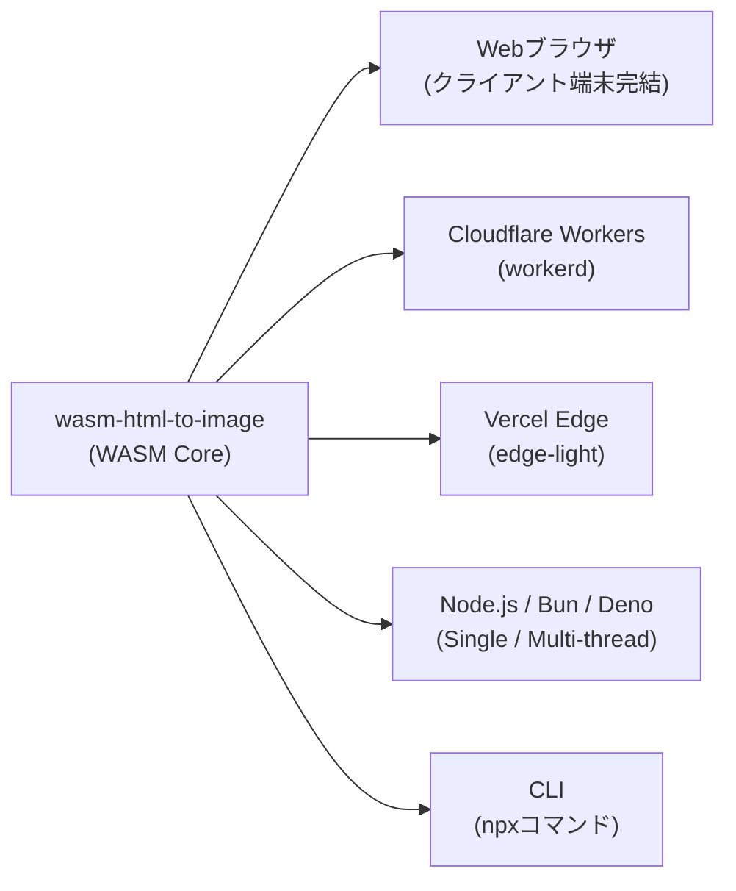

Web アプリケーションで動的に OGP（Open Graph Protocol）画像やソーシャルカード、バナーを生成したいとき、どのようなツールを選んでいるでしょうか？

これまでは、Puppeteer や Playwright などのヘッドレスブラウザを起動してスクリーンショットを撮るか、Vercel の Satori、Rust 製の Takumi といった軽量エンジンを使うのが主流でした。しかし、Puppeteer は「起動やメモリが重く Edge で動かない」、Satori は「CSS の制約が厳しく静止画 SVG のみ」、Takumi は高速でアニメーションに対応するものの「日本語の縦書きができない」「`backdrop-filter` などの高度な CSS が使えない」といった課題がそれぞれ存在していました。

こうした課題をクリアし、ブラウザ不要・ネイティブ依存ゼロで、高度な CSS・日本語縦書き・アニメーションまでブラウザ同等レベルのレンダリングを実現する npm パッケージを作成しました。それが `wasm-html-to-image` です。

https://www.npmjs.com/package/wasm-html-to-image

- 出力例 (アニメーションが気持ち悪いのは気のせいです)


本記事では、Satori や Takumi との違いを比較しつつ、`wasm-html-to-image` の特徴や動作環境、実践的なコード例を紹介します。

:::message
ブラウザ上で HTML/CSS を編集してレンダリング結果（画像・WebP・GIF）を確認できる Playground を公開しています。
初回は WASM の読み込みに時間がかかりますが、2回目以降は純粋なレンダリング時間だけで動作します。
👉 [wasm-html-to-image Playground](https://sorakumo001.github.io/wasm-html-to-image/master)
:::

---

## 1. OGP・画像生成エンジンの進化と Satori / Takumi との比較

これまでサーバーサイドやエッジで HTML から画像を生成するアプローチは、いくつかの世代を経て進化してきました。

```mermaid
flowchart TD
  subgraph Gen1["第1世代: ヘッドレスブラウザ"]
    P["Puppeteer / Playwright"] -->|"Chromium起動 (数百MB)"| P_OUT["高精度だが重い・Edge不可"]
  end

  subgraph Gen2["第2世代: Satori"]
    S["Satori (Yoga WASM)"] -->|"JSX → SVG文字列"| S_SVG["SVG"]
    S_SVG -->|"別途 resvg / sharp で変換"| S_OUT["軽量だが2段階・CSS制限大"]
  end

  subgraph Gen3["第3世代: Takumi"]
    T["Takumi (Rust / Taffy)"] -->|"単一パイプライン"| T_OUT["高速・アニメーション対応だが縦書きや高度CSSは非対応"]
  end

  subgraph Gen4["第4世代: wasm-html-to-image"]
    W["litehtml + Skia + HarfBuzz (WASM)"] -->|"フルCSS / 縦書き / キーフレーム / Sharp代替"| W_OUT["Skia描画 / 縦書き / アニメーション / 単一render()統合"]
  end
```



それぞれのエンジンの違いを整理したのが以下の比較表です。

| 項目 | Satori (Vercel) | Takumi (takumi-js) | wasm-html-to-image |
| :--- | :--- | :--- | :--- |
| コアエンジン | Yoga (C++ WASM) | Taffy + Parley (Rust) | litehtml + Google Skia + HarfBuzz (C++ WASM) |
| 出力パイプライン | JSX $\to$ SVG 文字列<br>*(※PNG化には resvg 等が別途必要)* | JSX/HTML $\to$ 画像 (直出力) | HTML/JSX/URL/画像 $\to$ 画像 / 動画 / PDF (直出力) |
| CSS サポート | Flexbox の一部サブセットのみ<br>*(Grid・疑似要素・高度なCSS不可)* | Flexbox / 一部 Grid<br>*(速度優先、`backdrop-filter` 等は非対応)* | CSS Grid, 疑似要素(`::before/after`), `:has()`, `clip-path`, `backdrop-filter` 等 |
| 日本語・縦書き | ❌ 非対応（横書きのみ） | ❌ 非対応 | ⭕ 完全対応 (`writing-mode: vertical-rl`, 縦中横, HarfBuzz) |
| CSS アニメーション | ❌ 静止画のみ | ⭕ 対応 (`renderAnimation` で WebP / APNG / GIF) | ⭕ 完全対応 (`@keyframes` $\to$ Animated WebP / APNG / GIF) |
| 画像処理 (Sharp代替)| ❌ なし | ❌ なし | ⭕ バッファ直接入力でリサイズ・クロップ・AVIF/JXL/TIFF・ThumbHash |
| ブラウザ動作 | △ (別途ラスタライザが必要) | ⭕ WASM 動作 | ⭕ 単一 WASM でブラウザ完結動作（Playgroundあり） |
| エッジ動作 | △ 依存関係が多く更新時に壊れやすい | ⭕ Cloudflare Workers 対応 | ⭕ ゼロ依存・単一 WASM (Workers / Edge-Light 対応) |

wasm-html-to-image は実サイトのURLを指定してそのままレンダリングできます。つまりこのパッケージの開発は、インターネット上のあらゆるリソースに対して、実ブラウザとの動作の違いを検証できます。これを繰り返すことによって、どんどん問題を修正していくことが可能です。

### 主な特徴

1. Google Skia によるブラウザ直系の高度な CSS・グラフィックス表現  
   Satori はもちろん、Rust 製で高速な Takumi でもレンダリング速度や設計の都合上、`backdrop-filter`（すりガラス効果）や複雑なフィルタ、`clip-path`、`corner-shape`、高度な CSS セレクタ（`:has()`, `:not()`, 疑似要素）は省略または非対応となっています。`wasm-html-to-image` は Chromium の描画エンジンでもある Google Skia と litehtml を搭載しているため、ブラウザと同等のリッチなグラフィックス効果をそのまま描画できます。

2. HarfBuzz 統合による本格的な日本語・縦書き対応  
   Satori や Takumi では対応が難しい「日本語の縦書き」や「縦中横（`text-combine-upright`）」に完全対応しています。多言語テキストシェーピングの業界標準である HarfBuzz を内包しているため、`writing-mode: vertical-rl` を指定するだけで、和風デザインや詩・小説の OGP、短冊カードを崩れることなく美しく生成できます。

3. 「HTML レンダラー＋画像処理（Sharp 代替）」を単一の `render()` API に統合  
   Takumi は静止画出力（`render`）、SVG（`renderSvg`）、アニメーション（`renderAnimation`）と用途ごとに関数が分かれていますが、`wasm-html-to-image` は単一の `render()` 関数にすべてが統合されたポリモーフィックな設計になっています。HTML 文字列を渡せば OGP 生成、`animation` オプションをつければ動画生成、画像バッファ（Buffer）を直接渡せばリサイズ・AVIF/TIFF 変換・ThumbHash 生成と、あらゆる画像ユースケースをこの 1 つのライブラリで完結できます。

4. 画像から画像への直接変換  
   HTML だけでなく、画像をソースにしてサイズやフォーマットの変換をかけることができます。画像を軽量化するライブラリとしても利用可能です。

---

## 2. wasm-html-to-image で出来ること

単なる「HTML から PNG への変換」にとどまらず、画像・ドキュメント生成に必要な機能が揃っています。

### 入力と出力フォーマット
- 入力:
  - HTML 文字列: Flexbox / Grid / 縦書き / CSS アニメーション対応
  - HTML 配列 (`string[]`): 複数ページのベクター PDF を生成
  - URL (`url`): リモートの Web ページをブラウザなしで直接キャプチャ
  - 画像バッファ (`Uint8Array` / `Buffer` / Data URL): 画像処理エンジンとして利用
- 出力フォーマット (`format`):
  - 静止画像: `png`, `jpeg`, `webp`, `avif`, `jxl`, `tiff`, `svg`, `raw`
  - アニメーション画像: `webp` (Animated WebP), `apng`, `gif`
  - ドキュメント: `pdf` (ベクター PDF)
  - プレースホルダー: `thumbhash` (軽量なブラー画像データ)

### 印刷向け CMYK 出力と TIFF 対応
`format: "tiff"` による TIFF 出力（Deflate 圧縮、アルファチャンネル保持）に対応しています。
さらに `colorSpace: "cmyk"` オプション（CLI では `--color-space cmyk`）を指定することで、印刷（DTP）向けに CMYK 色空間での出力が可能です。
- TIFF: 透明部分を白背景に合成した Separated CMYK 画像を出力
- PDF: ページ内のすべての塗り、線、RGB 画像を DeviceCMYK に書き換えて出力

### 画像処理エンジン（Sharp の代替）としての動作
HTML 文字列ではなく画像のバイト配列（Buffer）を直接渡すと、HTML のレイアウトパスをスキップして高速なリサイズ、クロップ（切り抜き）、最新フォーマット（WebP, AVIF, JXL, TIFF）への変換を行えます。ネイティブモジュール（Sharp 等）のインストールが難しい環境でも利用しやすいのがメリットです。

---

## 3. 動作環境（ユニバーサルランタイム対応）

`wasm-html-to-image` は、すべての処理が自己完結した WebAssembly モジュールで構成されているため、JavaScript が動くほぼすべての場所でそのまま動作します。



### 用途に応じたサブパス

パッケージには環境や目的に最適化されたエントリポイント（サブパス）が用意されています。

| サブパス | 対象環境 | 特徴 |
| :--- | :--- | :--- |
| `wasm-html-to-image` | ユニバーサル（推奨） | 自動判定（Cloudflare では `workerd`、他では `single` を自動選択） |
| `wasm-html-to-image/single` | Node.js, バンドラ | 単一バンドルされた WASM バイナリ |
| `wasm-html-to-image/workerd` | Cloudflare Workers | `WebAssembly.Module` 最適化 |
| `wasm-html-to-image/edge-light` | Vercel Edge Runtime | Strict Edge 制約向け |
| `wasm-html-to-image/workers` | Node.js, Web Workers | マルチスレッド Worker Pool による並列バッチ処理 |
| `wasm-html-to-image/react` | React (JSX) | JSX エレメントツリーを直接レンダリング |
| `wasm-html-to-image/preact` | Preact (JSX) | Preact エレメントツリーを直接レンダリング |
| `wasm-html-to-image/tailwind` | Tailwind CSS / UnoCSS | `@theme` や `@apply`、`tw="..."` の CSS 解決 |

### クライアントサイド（ブラウザ）での動作
ブラウザ上でも直接動作するため、ユーザーの端末上で画像をリサイズ・クロップしたり、OGP プレビューや PDF をサーバーとの通信なしに即座に生成してダウンロードさせることができます。

---

## 4. クイックスタート & 動作確認

まずはインストールして、最も基本的なコードを動かしてみましょう。

```bash
npm install wasm-html-to-image
```

### 基本コード：HTML から PNG を生成する

`render()` 関数に HTML 文字列を渡すシンプルな API です。

```typescript
import { render } from "wasm-html-to-image";
import fs from "node:fs/promises";

const result = await render({
  value: `
    <div style="
      width: 1200px;
      height: 630px;
      background: linear-gradient(135deg, #1e293b 0%, #0f172a 100%);
      color: white;
      display: flex;
      flex-direction: column;
      justify-content: center;
      align-items: center;
      font-family: sans-serif;
    ">
      <h1 style="font-size: 64px; margin: 0; background: linear-gradient(to right, #38bdf8, #818cf8); -webkit-background-clip: text; color: transparent;">
        Hello, wasm-html-to-image!
      </h1>
      <p style="font-size: 28px; opacity: 0.8; margin-top: 16px;">
        Headless browser-free image generation
      </p>
    </div>
  `,
  width: 1200,
  height: 630,
  format: "png",
});

// result.data は Uint8Array
await fs.writeFile("output.png", result.data);
```

### コマンドライン（CLI）からワンライナーで実行する

Node.js 環境があれば、`npx` でコマンドラインから直接実行することも可能です。CI/CD パイプラインやスクリプトで重宝します。

```bash
# HTML ファイルから WebP を生成
npx wasm-html-to-image template.html -o banner.webp -w 1200 -h 630 -f webp -q 90

# HTML から印刷用の CMYK TIFF を生成
npx wasm-html-to-image print.html -o print.tiff -w 1200 -h 1600 -f tiff --color-space cmyk

# URL からスクリーンショットを撮影
npx wasm-html-to-image https://example.com -o screenshot.png -w 1280 -h 720
```

---

## 5. 実践！様々な活用レシピ

具体的なユースケースとコード例を紹介します。

### レシピ1：Cloudflare Workers で作る OGP ジェネレーター

Cloudflare Workers 上で動的に OGP 画像を生成して返すコードです。`wasm-html-to-image` をインポートするだけで、Wrangler 側で複雑な WASM ルール設定を追加することなく動作します。フォントなども必要に応じて自動的にダウンロードされます。

```typescript
import { render } from "wasm-html-to-image";

export default {
  async fetch(request: Request): Promise<Response> {
    const url = new URL(request.url);
    const title = url.searchParams.get("title") ?? "デフォルトタイトル";

    const result = await render({
      value: `
        <div style="
          width: 1200px;
          height: 630px;
          box-sizing: border-box;
          padding: 60px;
          background: #09090b;
          color: #fafafa;
          display: flex;
          flex-direction: column;
          justify-content: space-between;
          font-family: sans-serif;
        ">
          <div style="font-size: 24px; color: #a1a1aa;">My Tech Blog</div>
          <h1 style="font-size: 56px; line-height: 1.3; margin: 0;">
            ${title}
          </h1>
          <div style="font-size: 20px; color: #71717a;">Generated on Cloudflare Edge</div>
        </div>
      `,
      width: 1200,
      height: 630,
      format: "webp",
      quality: 85,
    });

    return new Response(result.data, {
      headers: {
        "Content-Type": "image/webp",
        "Cache-Control": "public, max-age=86400",
      },
    });
  },
};
```

### レシピ2：HarfBuzz 連携による日本語縦書きカードの生成

和風デザインや名言カード、短冊、電子書籍風レイアウトに必要な縦書きも、標準の CSS `writing-mode: vertical-rl` を書くだけで正確にレイアウトされます。

```typescript
import { render } from "wasm-html-to-image";
import fs from "node:fs/promises";

const result = await render({
  value: `
    <div style="
      width: 600px;
      height: 800px;
      background: #fdfbf7;
      color: #292524;
      padding: 60px;
      box-sizing: border-box;
      display: flex;
      justify-content: center;
      align-items: center;
      border: 8px solid #d6d3d1;
    ">
      <div style="
        writing-mode: vertical-rl;
        font-family: 'Noto Serif JP', serif;
        height: 600px;
        display: flex;
        gap: 40px;
      ">
        <h1 style="font-size: 38px; letter-spacing: 0.15em; margin: 0;">
          ゆく河の流れは絶えずして、しかももとの水にあらず。
        </h1>
        <p style="font-size: 22px; color: #78716c; margin: 0; align-self: flex-end;">
          方丈記 — 鴨長明
        </p>
      </div>
    </div>
  `,
  width: 600,
  height: 800,
  format: "png",
});

await fs.writeFile("tategaki.png", result.data);
```

:::message
Google Fonts（Noto Sans JP や Noto Serif JP 等）は、ネットワーク接続があればレンダリング時に自動的にダウンロード・キャッシュされます。特別なフォント埋め込み処理は不要です。
:::

### レシピ3：CSS `@keyframes` から作るアニメーション WebP / GIF

`animation` オプションを指定するだけで、CSS のキーフレームアニメーションをコマ送りサンプリングしてアニメーション画像を出力できます。

```typescript
import { render } from "wasm-html-to-image";
import fs from "node:fs/promises";

// 1.5秒間の回転スピナーアニメーションを Animated WebP として書き出す
const result = await render({
  value: `
    <style>
      @keyframes spin {
        0% { transform: rotate(0deg); }
        100% { transform: rotate(360deg); }
      }
      .container {
        width: 300px;
        height: 300px;
        background: #0f172a;
        display: flex;
        justify-content: center;
        align-items: center;
      }
      .spinner {
        width: 80px;
        height: 80px;
        border: 8px solid #334155;
        border-top: 8px solid #38bdf8;
        border-radius: 50%;
        animation: spin 1.5s linear infinite;
      }
    </style>
    <div class="container">
      <div class="spinner"></div>
    </div>
  `,
  width: 300,
  height: 300,
  format: "webp",
  animation: 1500,    // アニメーション周期（ミリ秒）
  animationFps: 20,   // フレームレート
});

await fs.writeFile("spinner.webp", result.data);
```

### レシピ4：ブラウザ（クライアントサイド）での画像生成・書き出し

サーバーにリクエストを送ることなく、ブラウザ上で直接 OGP やダウンロード用画像を生成できます。

```html
<script type="module">
  import { render } from "https://esm.sh/wasm-html-to-image";

  const btn = document.getElementById("generate-btn");
  btn.addEventListener("click", async () => {
    const result = await render({
      value: `<div style="padding: 40px; background: #6366f1; color: white; font-family: sans-serif;">
        <h2>ブラウザ上で直接生成されました！</h2>
      </div>`,
      width: 600,
      height: 300,
      format: "png",
    });

    // 生成されたバイナリから Blob URL を作成して表示
    const blob = new Blob([result.data], { type: "image/png" });
    const imgUrl = URL.createObjectURL(blob);
    document.getElementById("preview").src = imgUrl;
  });
</script>
```

### レシピ5：大規模バッチ処理 & サーバー高速化（WASM 再利用）

高トラフィックな Node.js サーバーで毎回 WASM を初期化するとオーバーヘッドが生じます。`loadHtmlToImageModule()` を使って起動時に一度だけインスタンス化しておくことで、オーバーヘッドを抑えたスループットを実現できます。

```typescript
import { loadHtmlToImageModule, htmlToImage } from "wasm-html-to-image/index";
import express from "express";

const app = express();

// サーバー起動時に WASM モジュールを 1 回だけコンパイル・ロード
const mod = await loadHtmlToImageModule();

app.get("/ogp", async (req, res) => {
  const result = await htmlToImage(mod, {
    value: `<h1>${req.query.title ?? "OGP"}</h1>`,
    width: 1200,
    height: 630,
    format: "webp",
    quality: 85,
  });

  res.type("image/webp").send(Buffer.from(result.data));
});

app.listen(3000);
```

さらに、マルチコア CPU を活用して大量の画像を並列生成したい場合は、`wasm-html-to-image/workers` を使うことでワーカースレッドプールによる並列処理が可能です。

### レシピ6：印刷・DTP向けの CMYK TIFF / PDF 生成

Web 上で組んだレイアウトを印刷用の入稿データとして書き出したい場合、`colorSpace: "cmyk"` を指定することで DeviceCMYK な TIFF や PDF を直接生成できます。

```typescript
import { render } from "wasm-html-to-image";
import fs from "node:fs/promises";

// 印刷用の CMYK TIFF 画像を生成
const result = await render({
  value: `
    <div style="
      width: 1200px;
      height: 1800px;
      padding: 80px;
      background: #ffffff;
      color: #000000;
      font-family: sans-serif;
    ">
      <h1 style="font-size: 60px; margin: 0;">フライヤータイトル</h1>
      <p style="font-size: 24px; color: #444444; margin-top: 20px;">
        CMYK 色空間で直接出力した印刷用データ
      </p>
    </div>
  `,
  width: 1200,
  height: 1800,
  format: "tiff",
  colorSpace: "cmyk",
});

await fs.writeFile("flyer.tiff", result.data);
```

:::message
色空間の変換はデバイス式（K = 1 − max(R,G,B) など）に基づく変換です。印刷所指定の ICC プロファイルによる厳密な色校正が必要な場合は、適宜プロファイルの適用を行ってください。
:::

---

## 6. 利用時の注意点

- `<script>` は実行されない  
  セキュリティおよび軽量化の観点から、`<script>` タグの実行や `onClick` 等のイベントリスナー、`<canvas>` の 2D コンテキスト操作は動作しません。静的な HTML / CSS、またはインライン `<svg>` でマークアップしてください。
- CSS アニメーションはサンプリング実行  
  アニメーションは指定した `animation`（ミリ秒）と `animationFps` に基づいてキーフレームがサンプリングされ、動画フレームとしてエンコードされます。
- オフライン・閉域環境でのフォント指定  
  デフォルトでは Google Fonts を自動取得しますが、インターネットアクセスのない環境や厳密なエッジ環境では、`fallbackFonts` や `fonts` オプションにフォントバイナリ（Buffer）を渡すことで完全オフラインで動作させることができます。

---

## 7. まとめ

`wasm-html-to-image` は、従来のヘッドレスブラウザが抱えていた「重さ・デプロイの難しさ」と、軽量 OGP エンジンが抱えていた「CSS 制約・高度なグラフィックス効果の欠如・日本語縦書き非対応」という課題を解消するライブラリです。

- Puppeteer から移行したいが、Satori や Takumi では CSS やグラフィックスの自由度が足りなかった
- Cloudflare Workers などのエッジ環境で、安定して高品質な OGP や PDF を生成したい
- 日本語の縦書きや、Skia の描画能力を活かした CSS アニメーション（WebP/GIF）を作りたい
- ブラウザ上でサーバー負荷ゼロの画像エクスポート機能を作りたい
- Sharp などのネイティブ依存なしに、高速な画像リサイズや AVIF/TIFF 変換を行いたい
- 印刷用途（DTP）向けに、CMYK の TIFF や PDF を書き出したい

といった用途に幅広く活用できます。まずは公式 Playground で動作を試してみてください。

---

### 関連リンク
- GitHub: [SoraKumo001/wasm-html-to-image](https://github.com/SoraKumo001/wasm-html-to-image)
- Playground: [Demo Playground](https://sorakumo001.github.io/wasm-html-to-image/master)
- ドキュメント: [Docusaurus Docs](https://sorakumo001.github.io/wasm-html-to-image/master/docs/)
- サンプルコード集: [wasm-html-to-image-samples](https://github.com/SoraKumo001/wasm-html-to-image-samples)
