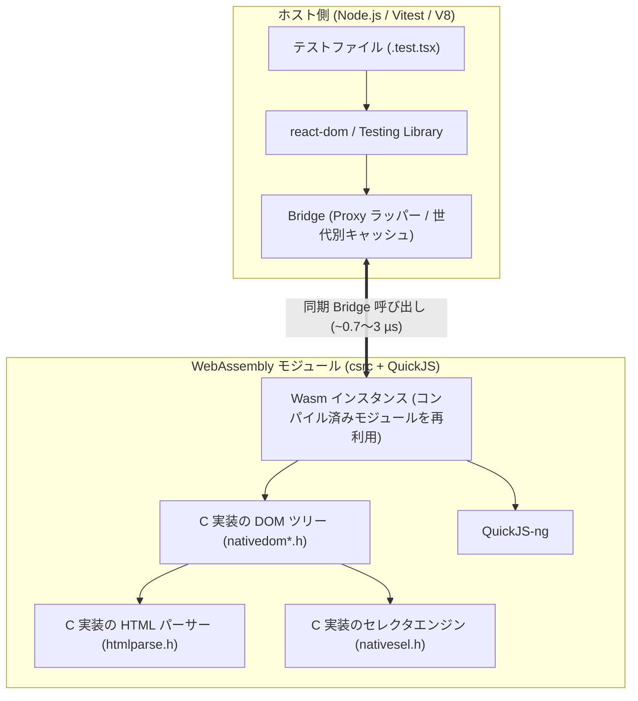

# はじめに

Vitest で React コンポーネントのテストを書いていると、ファイル数が増えるにつれて全体の実行時間が長くなっていきます。

個々のテストケースは数十ミリ秒で終わっているのに全体で時間がかかる原因の多くは、DOM 環境（`jsdom`）の初期化にあります。Vitest はテストの独立性を保つため、既定でテストファイルごとに環境を作り直します（`isolate: true`）。`jsdom` は 1 ファイルごとに約 1.1〜1.5 秒の初期化コストがかかるため、ファイル数が増えるほどこの待ち時間が積み重なります。

そこで、WebAssembly 上で動く軽量な DOM 実装 [`wasm-quickjs-dom`](https://www.npmjs.com/package/wasm-quickjs-dom) と、その Vitest 環境パッケージ [`vitest-environment-wasm-quickjs-dom`](https://www.npmjs.com/package/vitest-environment-wasm-quickjs-dom) を作り、`jsdom` とどの程度速度や挙動が違うのかを計測しました。

この記事では、ベンチマークの実測結果と、その裏にある WebAssembly・C 実装・Bridge の仕組みをまとめます。

---

# ベンチマーク結果の要約

同一マシン（AMD Ryzen 9 3900X 12-Core / Node.js v24.22.1 / Vitest 5.1.0 / React 19.3.1）で、同じ React テストとベンチマークを `jsdom`（31.0.0）と `wasm-quickjs-dom`（1.0.17）の両方で実行した結果です。

| 項目 | jsdom (31.0.0) | wasm-quickjs-dom (1.0.17) | 比較 |
| :--- | :--- | :--- | :--- |
| **1 ファイルあたりの環境起動コスト** | ~1,151.1 ms | **~187.3 ms** | **約 6.1 倍高速** |
| **テストスイート全体（並列・既定値 / 93件）** | 4,699.5 ms | **3,251.4 ms** | **0.69x（約 31% 短縮）** |
| **テストスイート全体（直列・1 worker / 93件）** | 24,053.1 ms | **13,113.3 ms** | **0.55x（約 45% 短縮）** |
| **React 23 シナリオの幾何平均** | 1.00x (基準) | 1.07x | 個別操作の平均はほぼ同等（7% 差） |
| **React テスト 93 件の互換性** | 93 / 93 passed | **93 / 93 passed** | テストコードの変更なしで全件パス |

ポイントは以下の 3 点です。

1. **テストファイル単位の起動が約 6 倍速い**  
   1 ファイルあたりの環境生成が `jsdom` の約 1,151 ms に対して `wasm-quickjs-dom` は約 187 ms で終わります。ファイル数が複数あるプロジェクトではこの差がそのまま効き、テストスイート全体の実行時間が並列で約 3 割、直列で約 45% 短縮されました。
2. **個別の DOM 操作には得手・不得手がある**  
   大量ノードの `unmount` や `textContent` の読み取り、`querySelectorAll` の走査は `wasm-quickjs-dom` が 2.4〜3.1 倍速い一方、小さなコンポーネントの単発マウントや `fireEvent` の連続発火は `jsdom` の方が 1.5〜2 倍速くなります。23 シナリオ全体の幾何平均は `1.07x` で、テスト本体の実行時間はほぼ同水準です。
3. **React 19 のテスト 93 件がそのまま通る**  
   Hooks（`useId`, `useDeferredValue`, `useSyncExternalStore` 等）、フォーム操作、Suspense、ErrorBoundary、Portal、Fake Timers、`user-event` などを含む 93 件のテストが、コードの書き換えなしで両方ともパスしています。

---

# なぜこの速度特性になるのか（内部構造）

`jsdom` と `wasm-quickjs-dom` では、DOM が置かれている場所が異なります。



## 1. Wasm モジュールのキャッシュとスナップショット起動

`jsdom` は純粋な JavaScript で実装されているため、環境を作るたびに多数のモジュールと Web IDL クラス群を V8 上で初期化するコストがかかります。

`wasm-quickjs-dom` では、ビルド時にブラウザグローバルや DOM の初期化処理を QuickJS のバイトコードとして焼き込んでいます。さらに Node.js ワーカープロセス内で `quickjs.wasm` を一度だけコンパイルして `WebAssembly.Module` として保持します。

```ts:packages/quickjs-dom/src/jsdom.ts
let compiled: WebAssembly.Module | undefined;
function defaultWasm(): WebAssembly.Module {
  if (compiled) return compiled;
  compiled = new WebAssembly.Module(readWasmBytes());
  return compiled;
}
```

そのため、2 ファイル目以降はコンパイル済みの Wasm モジュールから新しいインスタンスを立ち上げるだけで済み、環境初期化のオーバーヘッドが小さく抑えられます。

## 2. C 言語で書かれた DOM とセレクタエンジン

Wasm 内部の DOM ツリー（`csrc/nativedom*.h`）、HTML パーサー（`htmlparse.h`）、CSS セレクタエンジン（`nativesel.h`）はすべて C で書かれています。

HTML のパースやシリアライズ、`querySelectorAll` によるツリー走査、`textContent` の結合、アンマウント時のノード解放などは Wasm 内の C コードだけで完結します。JavaScript のオブジェクトを 1 つずつ辿る必要がないため、これらの処理は `jsdom` より 2.4〜3.1 倍速くなります。

## 3. ホスト（V8）と Wasm を繋ぐ Bridge の最適化

一方で、Vitest で React のテストを動かすときは、`react-dom` や Testing Library はホスト側（Node.js / V8）で動き、Wasm 内の DOM を Proxy ラッパー（`src/bridge.ts`）越しに操作します。

ホストから Wasm への境界越えには、1 回あたり約 2〜3 µs（キャッシュヒット時は約 0.7 µs）かかります。React のコミットフェーズや Testing Library のロール検索では何千回も DOM プロパティにアクセスするため、素直に毎回 Wasm を呼ぶと遅くなります。

これを抑えるため、`bridge.ts` と `qjsdom.c` には React や Testing Library のアクセスパターンに合わせた最適化を入れています。

### 不要な境界越えのショートサーキット

React や Testing Library が内部で全要素に対して確認するものの、ほとんどの要素では `undefined` になるプロパティをホスト側で即座に返しています。

```ts:packages/quickjs-dom/src/bridge.ts
// React はイベント発火時に毎回 target.correspondingUseElement を参照する。
// SVG の <use> 要素（t === 1: Element, l === "use"）以外は存在しないため、Wasm を呼ばずに undefined を返す
if (key === "correspondingUseElement" && cell.t === 1 && cell.l !== "use") return undefined;

// Testing Library はクエリ時に要素の labels プロパティを参照する。
// ラベル付け可能な要素（input, button, select 等）以外はホスト側で undefined を返す
if (key === "labels" && cell.t === 1 && cell.l !== undefined && !LABELABLE.has(cell.l) && !cell.l.includes("-")) return undefined;

// React がイベントシステムで登録する空関数 () => {} を検出し、不要なコールバック往復を省く
const EMPTY_FN_RE = /^(?:function\s*[\w$]*\s*\(\s*\)|\(\s*\)\s*=>)\s*\{\s*\}$/;
```

### 世代別キャッシュ（Generation-based Caching）

DOM の変更が起きても無関係なキャッシュを残せるように、世代カウンタを用途別に分けています。

- `treeGen`: 子要素の追加・削除などツリー構造の世代
- `attrGen`: 属性値の世代
- `codeGen`: ページ内スクリプト実行の世代
- `odGen`: ノードの所属 `ownerDocument` の世代

たとえばテキストや属性が変わっただけでは親子関係（`firstChild` / `nextSibling` 等）や `getRootNode()` のキャッシュを破棄せず、イベント発火（`dispatchEvent`）だけでは `ownerDocument` のキャッシュを破棄しないようにしています。v1.0.17 でこのキャッシュ維持条件を詰めた結果、1,000 行の再レンダリング（`rerender 1000 rows`）が **197.4 ms → 81.33 ms（約 2.4 倍高速化）** に改善し、`jsdom`（75.40 ms）とほぼ同じ速度になりました。

### C 関数への直通ルート

`createElement` や `appendChild`、`textContent` の取得など特に呼ばれる頻度が高い操作は、JSON RPC の文字列を介さず、数値のノード ID をそのまま C 関数に渡す専用ルートを通しています。

---

# ベンチマーク詳細

検証用のリポジトリ（[wasm-quickjs-dom-vitest-react-compare](https://github.com/SoraKumo001/wasm-quickjs-dom-vitest-react-compare)）で測定した全データです。

:::message
**測定方法についての補足**
- 1 つのファイル内で大量の DOM 生成を繰り返すと、前のシナリオの残骸による GC が計測中に割り込み、測定値が二峰性（例: 60 ms と 280 ms）になって大きくブレます。これを防ぐため、**23 個のシナリオをすべて 1 シナリオ＝1 テストファイルに分離**しています。
- サンプル間で明示的に GC（`--expose-gc`）を実行し、CPU の奪い合いを避けるため環境ごとに別プロセスで順番に計測しています。
:::

## 1. ファイルあたりの環境起動コスト

最小限のテストファイル 8 個を実行したときのスイート実行時間です。DOM を持たない `node` 環境をベースラインとして、1 ファイルあたりの DOM 環境の起動コストを算出しています。

| 環境 | 直列実行 (ms) | 並列実行 (ms) | node との差 (ms) | 1 ファイルあたり (ms) |
| :--- | ---: | ---: | ---: | ---: |
| `node`（ベースライン） | 2,220.0 | 834.0 | - | - |
| `jsdom` | 11,429.1 | 2,456.1 | +9,209.1 | **1,151.1** |
| `wasm-quickjs-dom` | 3,718.3 | 1,185.8 | +1,498.3 | **187.3** |

## 2. 同一テストスイート（93 テスト）の実行時間

11 ファイル・計 93 件の React テストスイート全体を実行したときの経過時間（Wall-clock time）です。

| 環境 | 直列 1 worker (ms) | 並列・既定値 (ms) |
| :--- | ---: | ---: |
| `jsdom` | 24,053.1 | 4,699.5 |
| `wasm-quickjs-dom` | **13,113.3** | **3,251.4** |
| **wasm / jsdom 比** | **0.55x** | **0.69x** |

テスト本体のみの合算時間（ウォームアップ込みの参考値）は `jsdom` が約 2,824 ms、`wasm-quickjs-dom` が約 2,737 ms（`0.97x`）とほぼ同じですが、ファイルごとの環境起動コストの差によって、全体の実行時間では `wasm-quickjs-dom` が 3〜4 割速く終わります。

## 3. React 23 シナリオ別の計測結果

`wasm/jsdom` が `1.00x` 未満の行は `wasm-quickjs-dom` の方が高速です。括弧内の数値は 1 操作あたりの時間を表します。

| シナリオ | jsdom (ms) | wasm-quickjs-dom (ms) | wasm/jsdom | 判定 | サンプル数 |
| :--- | ---: | ---: | ---: | :--- | ---: |
| `fireEvent.input` x50 | 8.07 (0.161/op) | 16.09 (0.322/op) | 1.99x | wasm 1.99x slower | 10 |
| `render <Counter/>` | 4.02 (0.803/op) | 7.77 (1.55/op) | 1.93x | wasm 1.93x slower | 40 |
| `fireEvent.click` x100 | 19.47 (0.195/op) | 34.79 (0.348/op) | 1.79x | wasm 1.79x slower | 10 |
| `getByLabelText` on 300 cards | 24.17 | 42.32 | 1.75x | wasm 1.75x slower | 10 |
| `getAllByRole('link')` on 300 cards | 34.70 | 58.21 | 1.68x | wasm 1.68x slower | 10 |
| `mount 1000 rows` | 100.4 | 149.3 | 1.49x | wasm 1.49x slower | 10 |
| `getByRole('button', {name})` on 300 cards | 52.09 | 74.81 | 1.44x | wasm 1.44x slower | 10 |
| `userEvent.type` 10 chars | 138.6 (13.86/op) | 197.4 (19.74/op) | 1.42x | wasm 1.42x slower | 6 |
| `mount 3000 rows` | 284.4 | 383.3 | 1.35x | wasm 1.35x slower | 6 |
| `mount 1000 simple rows` | 39.25 | 52.85 | 1.35x | wasm 1.35x slower | 10 |
| `findByText` (async query) on 300 cards | 29.29 | 37.14 | 1.27x | wasm 1.27x slower | 10 |
| `mount 100 rows` | 45.05 (15.02/op) | 56.51 (18.84/op) | 1.25x | wasm 1.25x slower | 16 |
| `form fill + submit` (`userEvent`) | 399.3 | 481.6 | 1.21x | wasm 1.21x slower | 6 |
| `mount 100 rows under a context provider` | 51.58 (17.19/op) | 60.43 (20.14/op) | 1.17x | wasm 1.17x slower | 12 |
| `rerender 1000 rows` | 75.40 (37.70/op) | 81.33 (40.67/op) | **1.08x** | **about the same** | 20 |
| `rerender <Counter/>` x100 | 15.57 (0.156/op) | 16.07 (0.161/op) | **1.03x** | **about the same** | 10 |
| `userEvent.click` x5 | 222.8 (44.56/op) | 215.9 (43.17/op) | **0.97x** | **about the same** | 6 |
| `getByText` on 300 cards | 23.33 | 22.31 | **0.96x** | **about the same** | 12 |
| `update 100 rows (5 prop changes)` | 17.57 (3.51/op) | 16.05 (3.21/op) | **0.91x** | **about the same** | 16 |
| `querySelectorAll('.row') + iterate, 1000 rows` | 10.13 | **4.21** | **0.42x** | **wasm 2.41x faster** | 10 |
| `expect(...).toHaveTextContent` on 1000 rows | 1.88 | **0.761** | **0.40x** | **wasm 2.47x faster** | 10 |
| `read textContent of 1000 rows` | 1.88 | **0.644** | **0.34x** | **wasm 2.92x faster** | 10 |
| `unmount 1000 rows` | 12.06 | **3.87** | **0.32x** | **wasm 3.12x faster** | 10 |

### 結果の読み解き

- **DOM の読み取りと破棄は `wasm-quickjs-dom` が 2.4〜3.1 倍高速**  
  `unmount 1000 rows`（3.12 倍）、`read textContent`（2.92 倍）、`toHaveTextContent`（2.47 倍）、`querySelectorAll`（2.41 倍）のように、C 側のツリー処理が主になるシナリオでは `wasm-quickjs-dom` が明確に速くなります。
- **再レンダリングや `getByText`、`userEvent.click` は同等**  
  `update 100 rows`（0.91x）や `getByText`（0.96x）、`rerender 1000 rows`（1.08x）は、Bridge のキャッシュが効くため `jsdom` とほぼ同じ時間になります。
- **細かいイベント連打や `getByRole` は `jsdom` が 1.4〜2 倍高速**  
  `fireEvent.input x50`（1.99x）や `getByLabelText`（1.75x）、`getAllByRole`（1.68x）では、V8 ヒープ内のオブジェクトを直接触れる `jsdom` の方が速くなります。ただし実時間で見ると `fireEvent.input` 50 回で 8 ms vs 16 ms（1 回あたり 0.16 ms の差）なので、通常のテストファイルでは環境起動コストの短縮分（約 960 ms）の方がはるかに大きく効きます。

---

# モック不要で使えるブラウザ API（Capability Probe）

`jsdom` でコンポーネントテストを書いていると、`window.matchMedia is not a function` や `IntersectionObserver is not defined` といったエラーに遭遇し、`setupFiles` にモックを書くことがよくあります。

両環境で 61 項目の DOM API の挙動を比較（`probes/capabilities.probe.ts`）したところ、基本的な DOM 操作や HTML パース・シリアライズ、CSS カスケード、フォーム、Range / Selection など 49 項目は同じ結果になり、以下の 12 項目に違いがありました。

| 項目 | jsdom (31.0.0) | wasm-quickjs-dom (1.0.17) |
| :--- | :--- | :--- |
| `typeof matchMedia` | `undefined` | `function` |
| `matchMedia('(min-width: 1px)').matches` | `undefined` | `true` |
| `typeof IntersectionObserver` | `undefined` | `function` |
| `typeof ResizeObserver` | `undefined` | `function` |
| `typeof scrollIntoView + call` | `TypeError: scrollIntoView is not a function` | `function`（エラーにならず呼べる） |
| `typeof requestIdleCallback` | `undefined` | `function` |
| `typeof navigator.clipboard` | `undefined` | `object` |
| `typeof Element.animate` | `undefined` | `function` |
| `navigator.userAgent` | `... jsdom/31.0.0` | `... Chrome/120.0` |
| `navigator.platform` | `""` | `"Linux"` |
| `window.innerWidth` | `1024` | `800` |
| `window.innerHeight` | `768` | `600` |

`wasm-quickjs-dom` では、`matchMedia`、`IntersectionObserver`、`ResizeObserver`、`scrollIntoView`、`requestIdleCallback`、`navigator.clipboard`、`Element.animate` が最初から実装されています。たとえば `IntersectionObserver` と `ResizeObserver` は `.observe()` 呼び出し時に一度コールバックを発火するため、遅延読み込みコンポーネントなどもモックなしでそのままテストできます。

一方で、`navigator.userAgent` の文字列や初期ビューポートサイズ（`800x600` vs `1024x768`）は `jsdom` と異なるため、これらに依存するテストがある場合は注意してください。また、どちらの環境も実際の画面レイアウト計算は行わないため、`getBoundingClientRect()` の幅や高さは基本的に `0` になります（`wasm-html-to-image` と組み合わせて `measureLayout` を使った場合を除く）。

---

# Vitest への導入方法

## 1. インストール

Vitest は `environment: "<name>"` に指定された名前から `vitest-environment-<name>` というパッケージを探します。そのため、`vitest-environment-wasm-quickjs-dom` を開発依存としてインストールします（内部で同じバージョンの `wasm-quickjs-dom` が自動的に入ります）。

```bash
pnpm add -D vitest-environment-wasm-quickjs-dom
# または
npm install -D vitest-environment-wasm-quickjs-dom
```

## 2. `vitest.config.ts` の変更

`test.environment` を `"wasm-quickjs-dom"` に変えるだけです。

```ts:vitest.config.ts
import { defineConfig } from "vitest/config";

export default defineConfig({
  test: {
    environment: "wasm-quickjs-dom",
    environmentOptions: {
      wasmQuickjsDom: {
        url: "http://localhost:3000",
      },
    },
  },
});
```

すでに `environmentOptions.jsdom`（`url` や `html` など）を設定している場合、`wasm-quickjs-dom` 側がそれをフォールバックとしてそのまま読み取るため、`environmentOptions` を書き換えなくても動きます。また、`vi.useFakeTimers()` もホスト側のタイマーと連動してそのまま使えます。

---

# まとめ

`jsdom` から `wasm-quickjs-dom` に切り替えたときの特徴を整理すると次のようになります。

- **向いているケース**
  - テストファイルが複数に分かれていて、ファイルごとの環境起動コスト（約 1.15 秒 → 約 0.19 秒）を減らしたいとき
  - 大きなリストやテーブルのテキスト検証（`textContent`, `querySelectorAll`）やアンマウント処理が多いとき
  - `matchMedia` や `IntersectionObserver`、`ResizeObserver`、`scrollIntoView` などのモックを `setupFiles` に書きたくないとき
- **気をつける点**
  - 1 つのファイル内で細かいイベント発火（`fireEvent`）や `getByRole` クエリを何百回も繰り返すマイクロベンチマーク的なテストでは、`jsdom` の方が速い場合がある
  - Node.js 20 以上かつ ESM 環境が必要（CommonJS の設定ファイルからは読み込めない）

設定ファイルの `environment` を 1 行変えるだけで試せるので、Vitest の実行時間が気になっている場合は試してみてください。

---

# 関連リンク

- npm: [wasm-quickjs-dom](https://www.npmjs.com/package/wasm-quickjs-dom)
- npm: [vitest-environment-wasm-quickjs-dom](https://www.npmjs.com/package/vitest-environment-wasm-quickjs-dom)
- GitHub（本体）: [SoraKumo001/wasm-html-to-image](https://github.com/SoraKumo001/wasm-html-to-image/tree/master/packages/quickjs-dom)
- GitHub（ベンチマーク再現リポジトリ）: [SoraKumo001/wasm-quickjs-dom-vitest-react-compare](https://github.com/SoraKumo001/wasm-quickjs-dom-vitest-react-compare)
